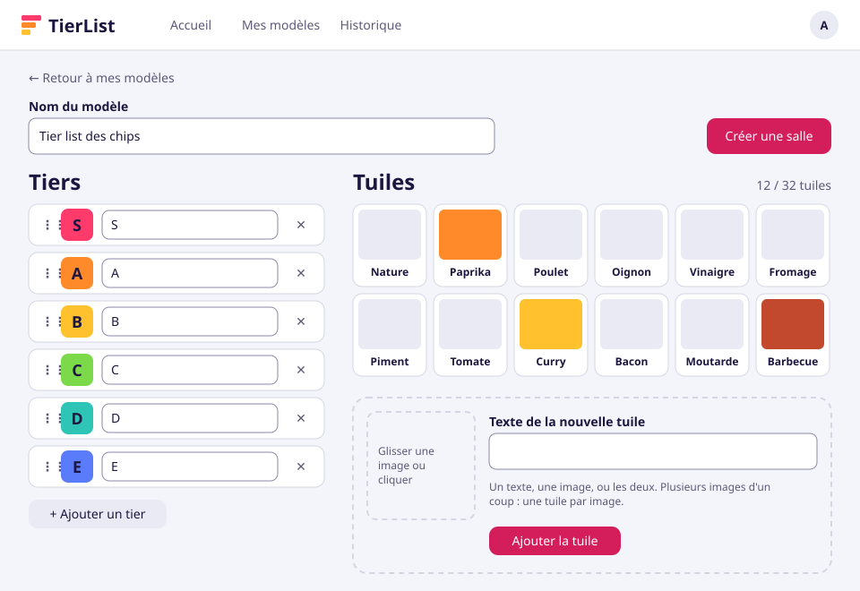
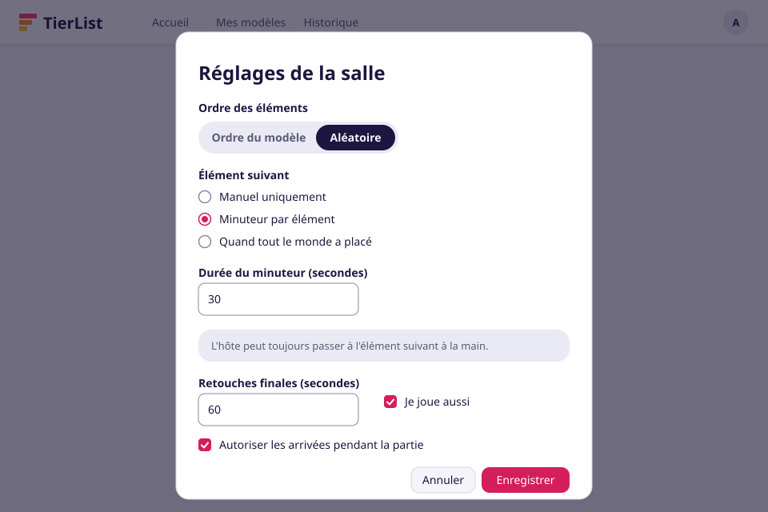
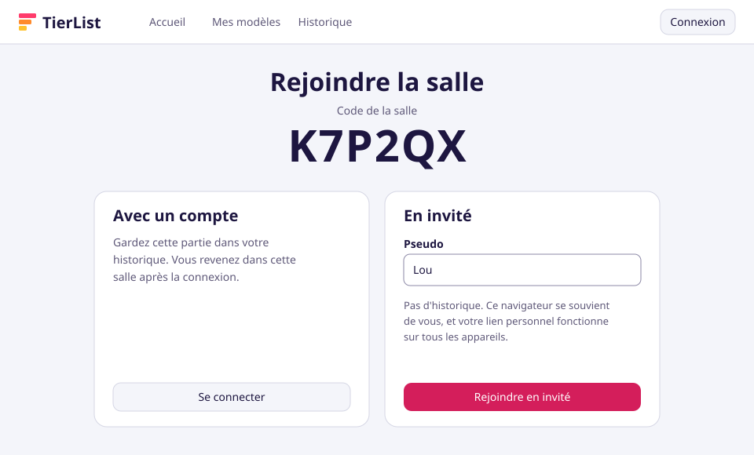
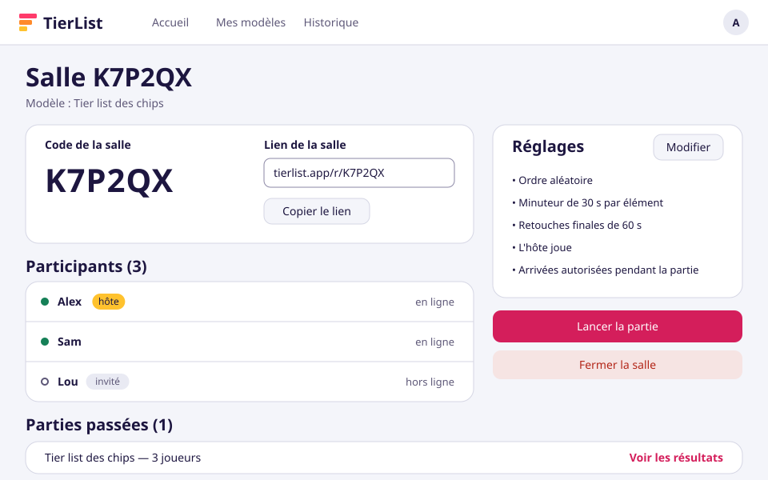
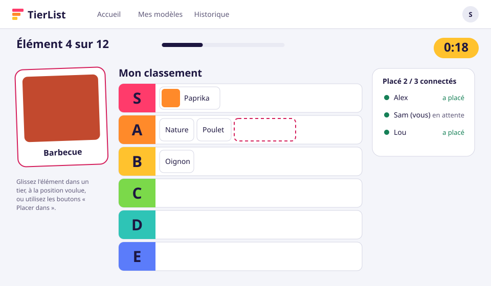
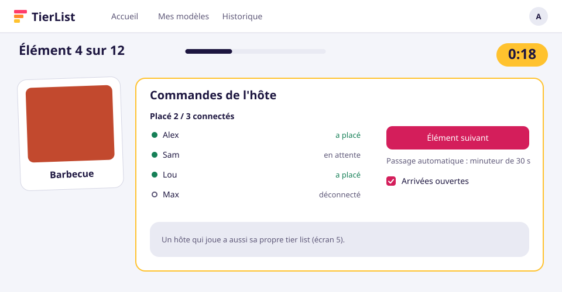
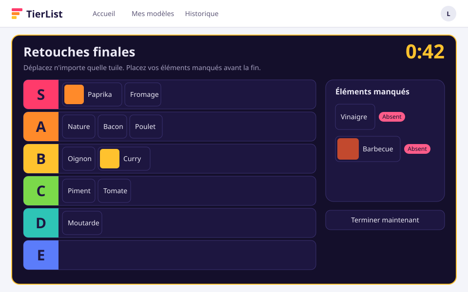
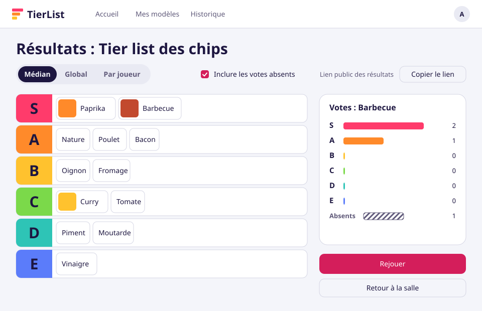

# Jalon 1 — Écrans

[English](screens.md) | Français

Les wireframes des écrans du [jalon 1](README.fr.md), dessinés sur l'[identité visuelle](../../technical/visual-identity.fr.md) « Le Plateau » avec les mots de l'interface. Ils montrent **ce que contient et fait chaque écran** ; les écrans livrés peuvent différer dans le détail, et l'application fait foi. Stories : [user-stories.fr.md](user-stories.fr.md).

Chaque image existe en français (affichée ici) et en anglais ([screens.md](screens.md)), dans [screens/](screens/).

Les images sont générées par [`scripts/screens/milestone_1.py`](../../../scripts/screens/milestone_1.py) : ne jamais modifier un SVG à la main, changer le script et le relancer. Ses textes viennent des traductions de l'interface : un libellé modifié est redessiné au lancement suivant. Depuis la racine du dépôt, une fois `pnpm install` lancé dans `frontend/` (les polices viennent de là), avec Node et uv :

```bash
uv run --project backend python scripts/screens/milestone_1.py
```

Le kit de dessin, [`scripts/screens/plateau.py`](../../../scripts/screens/plateau.py), regroupe les couleurs, les polices et les pièces de la charte (en-tête, boutons, panneaux, lignes de tier…), pour les écrans des jalons suivants. Il embarque Anybody et Geist dans chaque SVG, réduites aux caractères utilisés, pour que GitHub les affiche.

## 1. Éditeur de template



- **Stories** : US-1.1 à US-1.4.
- Tiers S à E par défaut ; chacun peut être renommé, recoloré (pastille de couleur), réordonné (poignée à gauche) ou supprimé.
- Les tuiles avec image montrent un emplacement d'image ; les tuiles texte seul affichent leur texte. Le compteur montre la limite de **32 tuiles**.
- « Créer une room » crée la room et ouvre son salon (écran 4), où ses réglages se changent (écran 2). La liste des templates (US-1.5) est une simple liste avec un état vide ; elle n'est pas dessinée.

## 2. Réglages de la room



- **Stories** : US-2.1, US-2.2.
- Les cinq réglages du jalon, dans le dialogue ouvert par « Modifier » dans le salon, entre deux parties. La note rappelle que l'admin de la room (l'**hôte** dans l'interface) peut **toujours** passer à la main.
- Pendant une partie, seules les arrivées peuvent changer.

## 3. Rejoindre une room



- **Stories** : US-2.4, US-2.5, US-5.4.
- L'écran vu **sans être connecté** : ouvrir le lien de la room remplit le code. « Se connecter » ramène ensuite dans la room ; sinon, un pseudo suffit.
- Un utilisateur **connecté** qui ouvre le lien ne voit pas cet écran : il entre directement dans la room avec son compte. Les utilisateurs connectés peuvent aussi saisir le code depuis l'appli.
- L'invité est prévenu qu'il n'a pas d'historique : le navigateur se souvient de lui, et son **lien perso** marche depuis n'importe quel appareil.

## 4. Salon



- **Stories** : US-2.3, US-2.6, US-2.7, US-2.9, US-3.1.
- La vue de l'**admin de la room** : code, lien, participants sur 10, résumé des réglages, lancer, fermer, parties passées de la room.
- Les participants voient le même écran sans les actions « Modifier », « Lancer la partie » et « Fermer la salle », et attendent le début de la partie.

## 5. Tour — participant



- **Stories** : US-3.2, US-3.3.
- Numéro de l'item, progression et timer en haut ; l'item en cours à gauche ; la tier list du participant ; qui a placé à droite (**board privé** : jamais où).
- L'emplacement en pointillés montre où l'item va tomber : le **tier et la position** comptent.

## 6. Tour — admin de la room



- **Stories** : US-3.4, US-3.5, US-4.3, US-2.10.
- « Item suivant » est toujours disponible, quel que soit le réglage automatique. Le compteur n'attend que les participants **connectés**.
- « Arrivées ouvertes » verrouille ou rouvre les arrivées pendant la partie ; les participants déjà dans la room peuvent toujours revenir.
- Un admin de la room qui joue voit ce panneau **et** sa propre tier list (écran 5).

## 7. Cooldown final



- **Stories** : US-4.1, US-4.2, US-4.6.
- Le cooldown final (« retouches finales » dans l'interface) se joue sur un **plateau sombre** quel que soit le thème, avec un compte à rebours : l'effet « sous pression ». Toutes les tuiles se déplacent.
- Les items manqués s'affichent à part, marqués **absent**, à placer avant la fin.
- L'admin de la room a aussi un bouton « Terminer maintenant ».

## 8. Résultats



- **Stories** : US-5.2, US-5.3, US-2.9.
- Trois vues : classement **médian** (affiché), **global** (répartition par item), **par joueur** (le classement de chaque participant).
- Le panneau de droite montre la répartition de l'item sélectionné, votes **absents** compris ; la case les inclut ou les exclut.
- « Copier le lien », à côté du lien public des résultats, partage les résultats. La **page publique** montre les mêmes vues, en lecture seule, sans « Rejouer » ni « Retour à la salle ».
