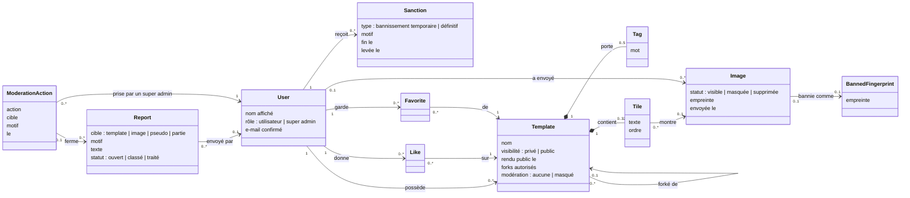

# Jalon 2 — Modèle de domaine

[English](domain-model.md) | Français

Les concepts métier que le [jalon 2](README.fr.md) ajoute ou modifie, leurs relations et les règles qu'ils respectent toujours. Les concepts du [jalon 1](../milestone-1/domain-model.fr.md) (rooms, parties, placements…) ne changent pas. C'est un modèle **conceptuel** : il nomme ce que le produit manipule, pas la façon de le stocker.

## Diagramme de classes

## Concepts

| Concept               | Sens                                                                                                                                                                                               |
| --------------------- | -------------------------------------------------------------------------------------------------------------------------------------------------------------------------------------------------- |
| **User**              | Un compte. Gagne un **rôle** (utilisateur ou super admin, attribué hors de l'application) et utilise son **e-mail confirmé** pour publier.                                                         |
| **Sanction**          | Un bannissement d'un compte par un super admin : **temporaire** (avec une date de fin) ou **définitif**, avec un motif. Il peut être levé.                                                         |
| **Template**          | Gagne une **visibilité** (privé ou public), sa date de passage en public, si les **forks sont autorisés**, un état de **modération**, et le template dont il est **forké**, s'il y en a un.        |
| **Tag**               | Un mot ou une courte expression choisi par le propriétaire, pour trouver le template. Comparé sans tenir compte de la casse ni des accents.                                                        |
| **Image**             | Le fichier envoyé d'une tuile (déjà stocké compressé). Gagne un **statut** de modération et une **empreinte** du fichier.                                                                          |
| **BannedFingerprint** | L'empreinte d'une image supprimée : le même fichier est refusé à l'envoi.                                                                                                                          |
| **Like**              | Le like d'un utilisateur sur un template public. Le nombre de likes est la **popularité** du template.                                                                                             |
| **Favorite**          | Un template public qu'un utilisateur garde pour le retrouver.                                                                                                                                      |
| **Report**            | Un signalement envoyé par n'importe qui sur un template, une image, un pseudo ou une partie, avec un motif. Envoyé par un compte, ou anonymement par un invité ou un visiteur (fréquence limitée). |
| **ModerationAction**  | Une entrée du **journal de modération** : quel super admin a fait quoi, sur quoi, quand et pourquoi. Elle peut fermer des signalements.                                                            |

La **marketplace** n'est pas un concept à part : c'est la liste des templates **référencés** (invariant 2), recherchés et triés.

## Invariants

Règles que le modèle respecte toujours, quel que soit l'écran ou l'action :

1. Seul un **super admin** peut prendre une action de modération ; le rôle n'est jamais attribué par l'application.
2. Un template est **référencé** dans la marketplace si et seulement s'il est **public**, **pas masqué** par la modération, **pas supprimé**, et que son propriétaire n'est **pas banni**.
3. Un template ne peut être rendu public que par son **propriétaire**, dont l'e-mail est **confirmé**, et seulement s'il n'est pas masqué par la modération.
4. Un template a **au plus 5 tags**, sans doublon (sans tenir compte de la casse ni des accents).
5. Un utilisateur a **au plus un like** et **au plus un favori** par template, et ne like jamais son propre template.
6. Les likes et favoris ne sont **affichés** que tant que leur template est référencé ; sinon ils sont gardés.
7. Un template ne peut être forké que tant qu'il est **référencé** et que son propriétaire **autorise les forks**. Un fork démarre **privé**, à la personne qui l'a forké, et garde **pour toujours** le template dont il est forké, même si celui-ci devient privé, masqué ou supprimé.
8. Une partie se joue sur un **snapshot** (jalon 1) : rendre un template privé, le masquer ou le supprimer ne change jamais une partie déjà commencée.
9. Une image **masquée** ou **supprimée** n'est jamais servie : un visuel « image retirée » la remplace partout. Le fichier d'une image supprimée disparaît pour de bon.
10. Une image dont l'empreinte est **bannie** ne peut pas être envoyée.
11. Un compte **banni** ne peut pas se connecter tant que son bannissement est actif ; un super admin ne peut jamais être banni.
12. Un contenu a **au plus un signalement ouvert** par auteur de signalement (un compte, ou le navigateur d'un invité ou d'un visiteur).
13. Chaque action de modération est écrite dans le **journal**, et ses entrées ne sont jamais modifiées ni supprimées.
