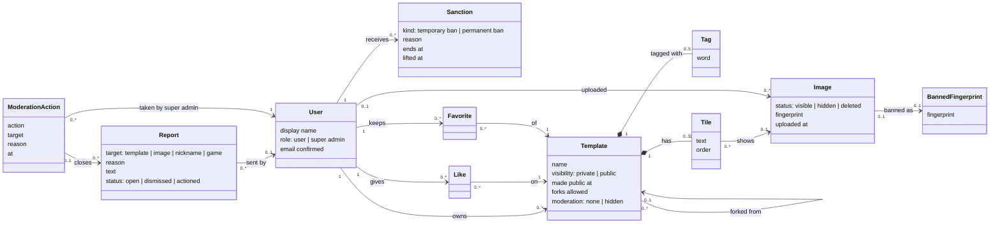

# Milestone 2 — Domain model

English | [Français](domain-model.fr.md)

The business concepts that [milestone 2](README.md) adds or changes, their relations and the rules they must always respect. The concepts of [milestone 1](../milestone-1/domain-model.md) (rooms, games, placements…) do not change. This is a **conceptual** model: it names what the product manipulates, not how it is stored.

## Class diagram

## Concepts

| Concept               | Meaning                                                                                                                                                                          |
| --------------------- | -------------------------------------------------------------------------------------------------------------------------------------------------------------------------------- |
| **User**              | An account. Gains a **role** (user or super admin, granted outside the app) and uses its **confirmed email** to publish.                                                         |
| **Sanction**          | A ban of an account by a super admin: **temporary** (with an end date) or **permanent**, with a reason. It can be lifted.                                                        |
| **Template**          | Gains a **visibility** (private or public), the date it was made public, whether **forks are allowed**, a **moderation** state, and the template it was **forked from**, if any. |
| **Tag**               | A word or short expression chosen by the owner, used to find the template. Compared without case or accents.                                                                     |
| **Image**             | The uploaded file of a tile (already stored compressed). Gains a moderation **status** and a **fingerprint** of the file.                                                        |
| **BannedFingerprint** | The fingerprint of a deleted image: the same file is refused at upload.                                                                                                          |
| **Like**              | A user's like of a public template. The number of likes is the template's **popularity**.                                                                                        |
| **Favorite**          | A public template a user keeps to find it again.                                                                                                                                 |
| **Report**            | A report sent by anyone about a template, an image, a nickname or a game, with a reason. Sent by an account, or anonymously by a guest or a visitor (rate limited).              |
| **ModerationAction**  | One entry of the **moderation log**: which super admin did what, on what, when and why. It may close reports.                                                                    |

The **marketplace** is not a concept of its own: it is the list of the templates that are **listed** (invariant 2), searched and sorted.

## Invariants

Rules the model always respects, whatever the screen or the action:

1. Only a **super admin** can take a moderation action; the role is never granted by the app.
2. A template is **listed** in the marketplace if and only if it is **public**, **not hidden** by moderation, **not deleted**, and its owner is **not banned**.
3. A template can be made public only by its **owner**, whose email is **confirmed**, and only if it is not hidden by moderation.
4. A template has **at most 5 tags**, without duplicates (ignoring case and accents).
5. A user has **at most one like** and **at most one favorite** per template, and never likes their own template.
6. Likes and favorites are **shown** only while their template is listed; they are kept otherwise.
7. A template can be forked only while it is **listed** and its owner **allows forks**. A fork starts **private**, owned by the person who forked it, and keeps the template it was forked from **forever**, even if that template becomes private, hidden or deleted.
8. A game is played on a **snapshot** (milestone 1): making a template private, hiding it or deleting it never changes a game already started.
9. A **hidden** or **deleted** image is never served: an "image removed" visual replaces it everywhere. A deleted image's file is gone for good.
10. An image whose fingerprint is **banned** cannot be uploaded.
11. A **banned** account cannot sign in while its ban is active; a super admin can never be banned.
12. A content has **at most one open report** per reporter (an account, or a guest's or visitor's browser).
13. Every moderation action is written to the **log**, and log entries are never edited or deleted.
