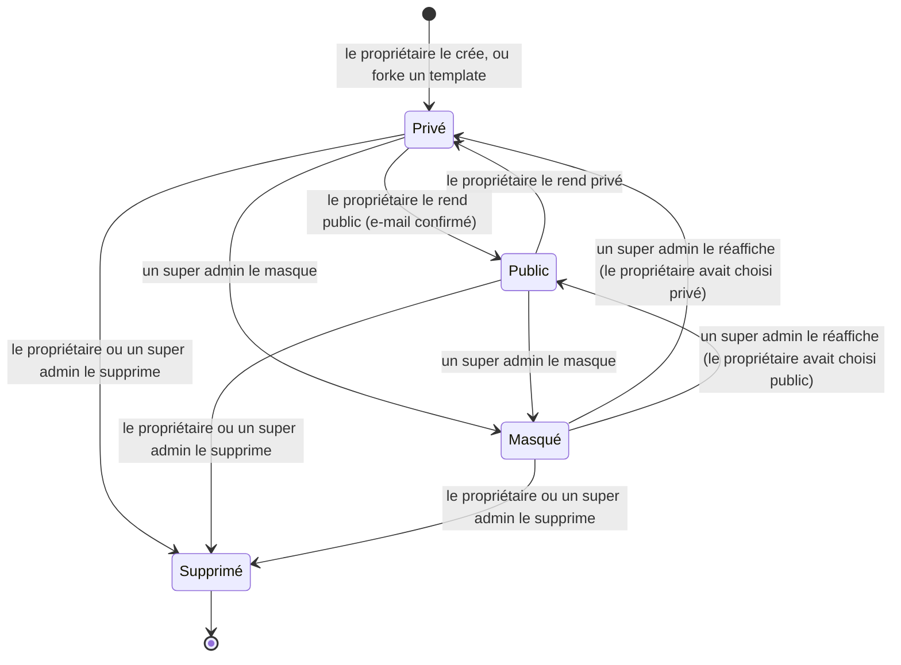
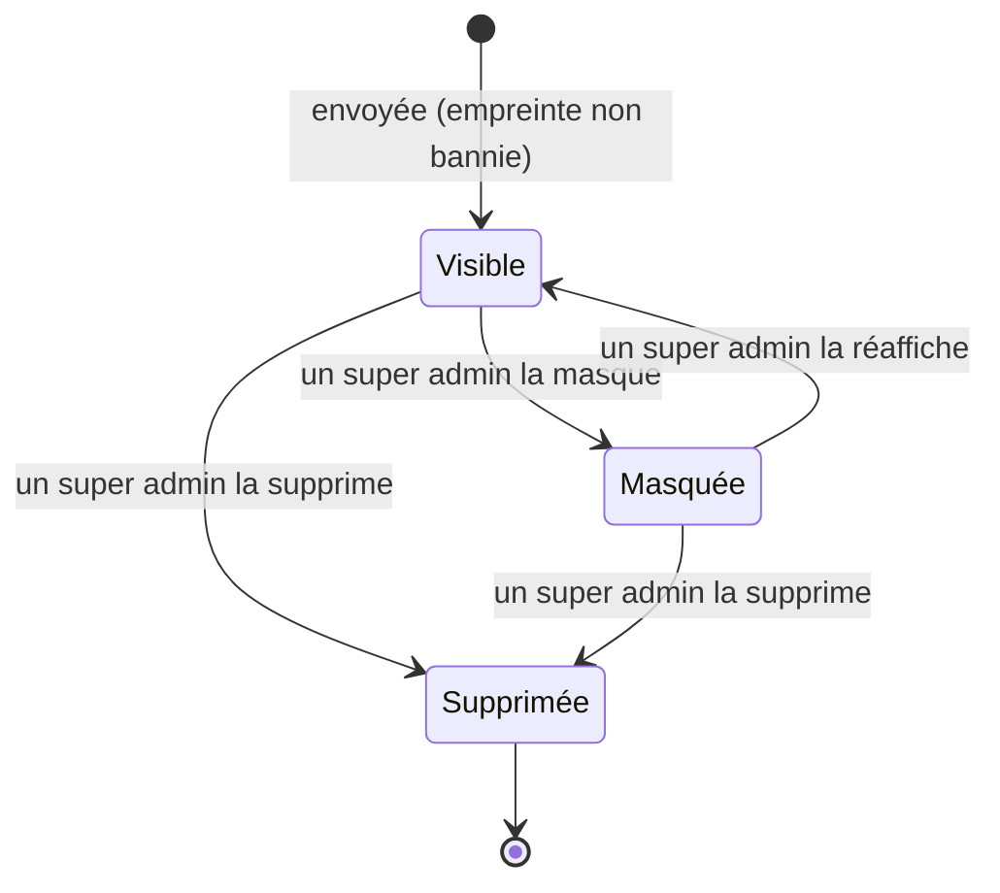
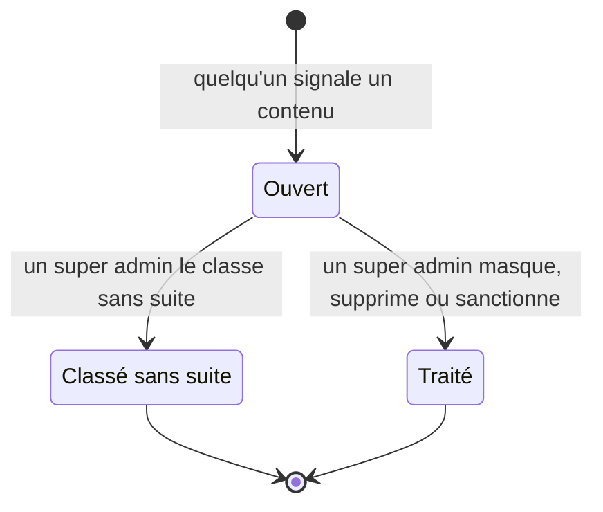
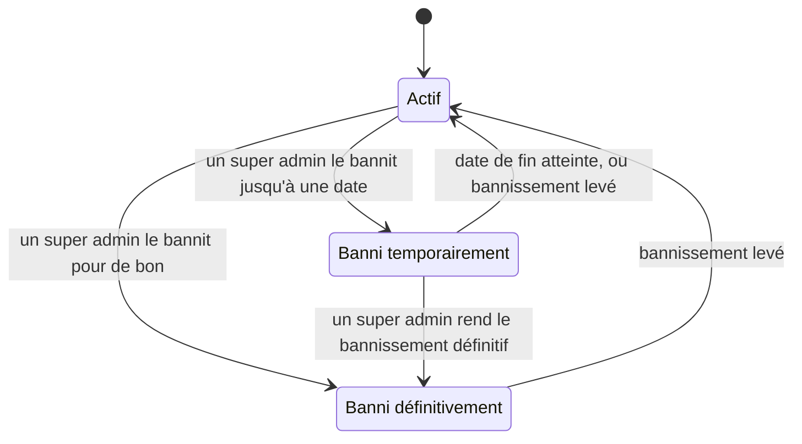

# Jalon 2 — Cycles de vie

[English](lifecycles.md) | Français

Les états des concepts du [jalon 2](README.fr.md) et ce qui les fait passer de l'un à l'autre. Concepts : [domain-model.fr.md](domain-model.fr.md). Stories : [user-stories.fr.md](user-stories.fr.md).

## Template

La **visibilité** choisie par le propriétaire et la **modération** décidée par un super admin sont séparées : réafficher un template lui rend la visibilité que son propriétaire avait choisie.

| État         | Sens                                                                                                                                                                                                | Référencé dans la marketplace           |
| ------------ | --------------------------------------------------------------------------------------------------------------------------------------------------------------------------------------------------- | --------------------------------------- |
| **Privé**    | Seul son propriétaire le voit et lance des rooms avec (jalon 1).                                                                                                                                    | Non                                     |
| **Public**   | Tout le monde peut l'ouvrir, lancer une room avec, le liker, le mettre en favori et, si c'est autorisé, le forker.                                                                                  | Oui, sauf si son propriétaire est banni |
| **Masqué**   | Retiré par la modération. Son propriétaire le voit et le modifie encore, avec le motif, mais ne peut pas le rendre public. Pas de nouvelle partie ; celles en cours se terminent.                   | Non                                     |
| **Supprimé** | Disparu pour son propriétaire (suppression logique, puis purge : [guide des templates](../../technical/templates.fr.md#23-suppression-logique-et-purge)). Les parties jouées gardent leur snapshot. | Non                                     |

| Transition         | Déclenchée par                            | Story          |
| ------------------ | ----------------------------------------- | -------------- |
| Privé → Public     | Le propriétaire, avec un e-mail confirmé. | US-2.1         |
| Public → Privé     | Le propriétaire.                          | US-2.3         |
| → Masqué           | Un super admin, avec un motif.            | US-1.5         |
| Masqué → précédent | Un super admin le réaffiche.              | US-1.5         |
| → Supprimé         | Le propriétaire, ou un super admin.       | US-2.3, US-1.5 |

## Image

| État          | Sens                                                                                                            |
| ------------- | --------------------------------------------------------------------------------------------------------------- |
| **Visible**   | Servie partout où ses tuiles apparaissent.                                                                      |
| **Masquée**   | Pas servie : un visuel « image retirée » la remplace partout. Le fichier est gardé, pour pouvoir la réafficher. |
| **Supprimée** | Final : le fichier est effacé et son empreinte est bannie. Le visuel « image retirée » reste.                   |

Une image qu'aucune tuile n'utilise plus est toujours nettoyée comme au jalon 1 ([guide des images](../../technical/images.fr.md)) ; ce n'est pas un état de modération.

## Signalement

| État                  | Sens                                                                                            |
| --------------------- | ----------------------------------------------------------------------------------------------- |
| **Ouvert**            | En attente dans la file, regroupé avec les autres signalements ouverts du même contenu.         |
| **Classé sans suite** | Fermé sans action : le contenu reste tel quel.                                                  |
| **Traité**            | Fermé par une décision (masquer, supprimer, bannir), enregistrée dans le journal de modération. |

Une décision sur un contenu ferme **tous** ses signalements ouverts d'un coup (US-1.3).

## Compte

| État                     | Sens                                                                                                                          |
| ------------------------ | ----------------------------------------------------------------------------------------------------------------------------- |
| **Actif**                | Le compte fonctionne normalement.                                                                                             |
| **Banni temporairement** | Déconnecté partout, ne peut pas se connecter avant la date de fin ; ses templates publics ne sont pas référencés entre-temps. |
| **Banni définitivement** | Pareil, sans date de fin. Seul un super admin peut le lever.                                                                  |

Les super admins ne sont jamais bannis (invariant 11).
