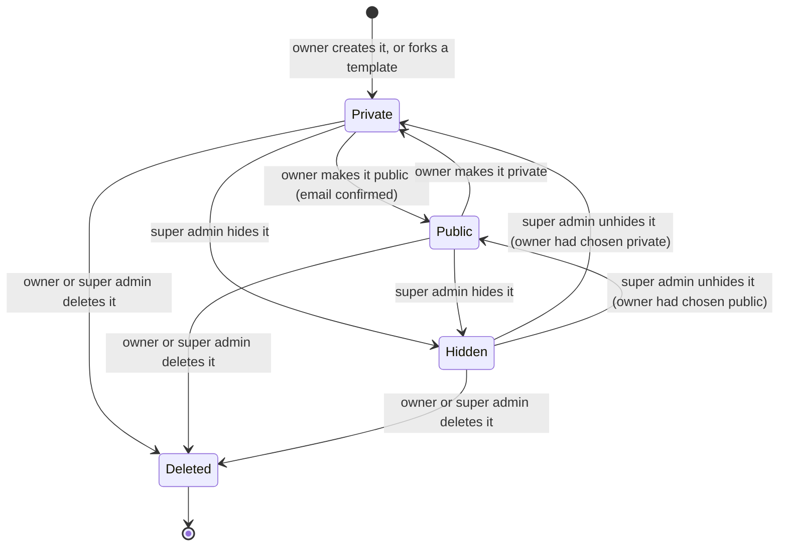
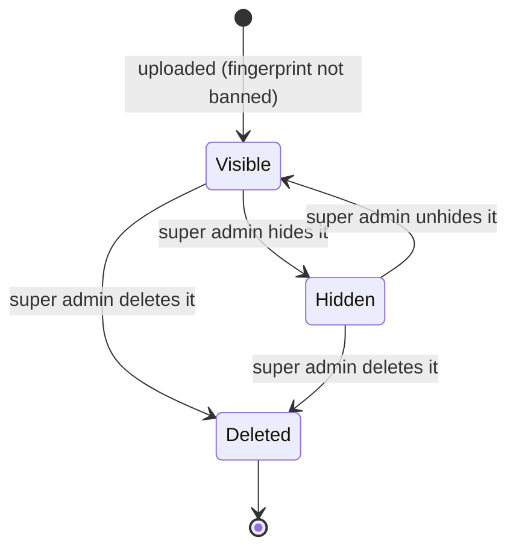
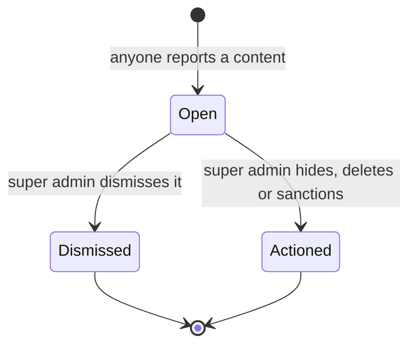
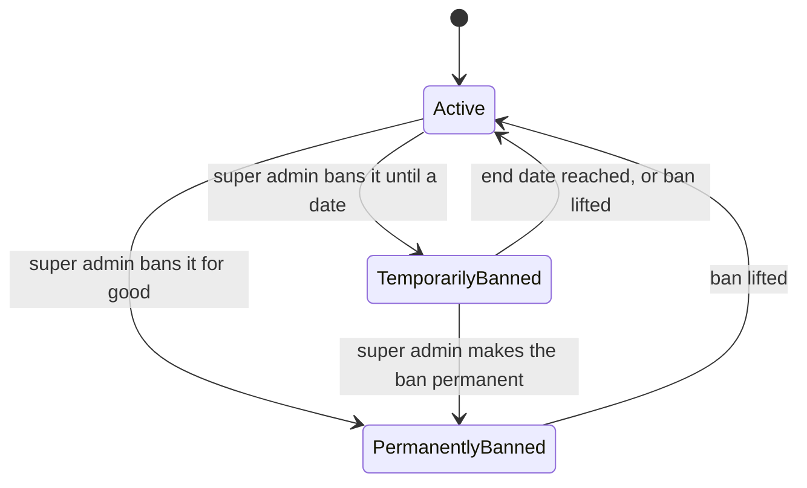

# Milestone 2 — Lifecycles

English | [Français](lifecycles.fr.md)

The states of the concepts of [milestone 2](README.md) and what moves them from one state to another. Concepts: [domain-model.md](domain-model.md). Stories: [user-stories.md](user-stories.md).

## Template

The **visibility** chosen by the owner and the **moderation** decided by a super admin are separate: unhiding a template gives back the visibility its owner chose.

| State       | Meaning                                                                                                                                                       | Listed in the marketplace       |
| ----------- | ------------------------------------------------------------------------------------------------------------------------------------------------------------- | ------------------------------- |
| **Private** | Only its owner sees it and starts rooms with it (milestone 1).                                                                                                | No                              |
| **Public**  | Everyone can open it, start a room with it, like it, add it to favorites and, if allowed, fork it.                                                            | Yes, unless its owner is banned |
| **Hidden**  | Removed by moderation. Its owner still sees and edits it, with the reason, but cannot make it public. No new game; games in progress finish.                  | No                              |
| **Deleted** | Gone for its owner (soft deletion, then purge: [templates guide](../../technical/templates.md#23-soft-deletion-and-purge)). Played games keep their snapshot. | No                              |

| Transition        | Triggered by                       | Story          |
| ----------------- | ---------------------------------- | -------------- |
| Private → Public  | The owner, with a confirmed email. | US-2.1         |
| Public → Private  | The owner.                         | US-2.3         |
| → Hidden          | A super admin, with a reason.      | US-1.5         |
| Hidden → previous | A super admin unhides it.          | US-1.5         |
| → Deleted         | The owner, or a super admin.       | US-2.3, US-1.5 |

## Image

| State       | Meaning                                                                                                   |
| ----------- | --------------------------------------------------------------------------------------------------------- |
| **Visible** | Served wherever its tiles appear.                                                                         |
| **Hidden**  | Not served: an "image removed" visual replaces it everywhere. The file is kept, so it can be shown again. |
| **Deleted** | Final: the file is erased and its fingerprint is banned. The "image removed" visual stays.                |

An image that no tile uses any more is still cleaned up as in milestone 1 ([images guide](../../technical/images.md)); this is not a moderation state.

## Report

| State         | Meaning                                                                           |
| ------------- | --------------------------------------------------------------------------------- |
| **Open**      | Waiting in the queue, grouped with the other open reports about the same content. |
| **Dismissed** | Closed without action: the content stays as it is.                                |
| **Actioned**  | Closed by a decision (hide, delete, ban), recorded in the moderation log.         |

A decision on a content closes **all** its open reports at once (US-1.3).

## Account

| State                  | Meaning                                                                                                  |
| ---------------------- | -------------------------------------------------------------------------------------------------------- |
| **Active**             | The account works normally.                                                                              |
| **Temporarily banned** | Signed out everywhere, cannot sign in until the end date; its public templates are not listed meanwhile. |
| **Permanently banned** | The same, with no end date. Only a super admin can lift it.                                              |

Super admins are never banned (invariant 11).
