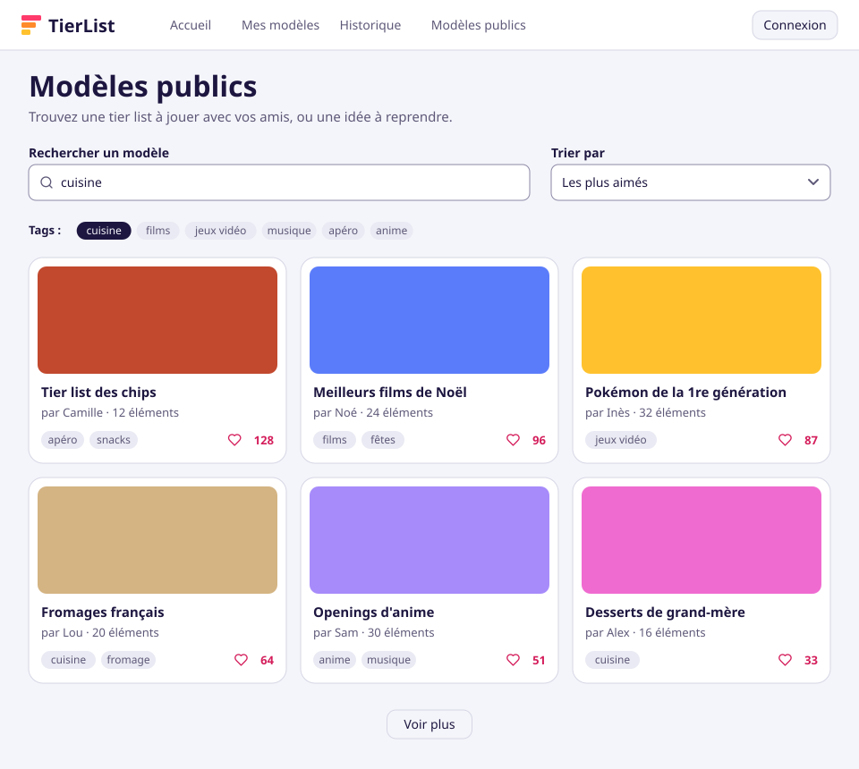
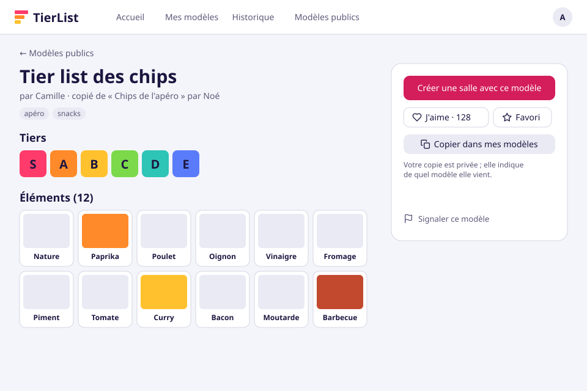
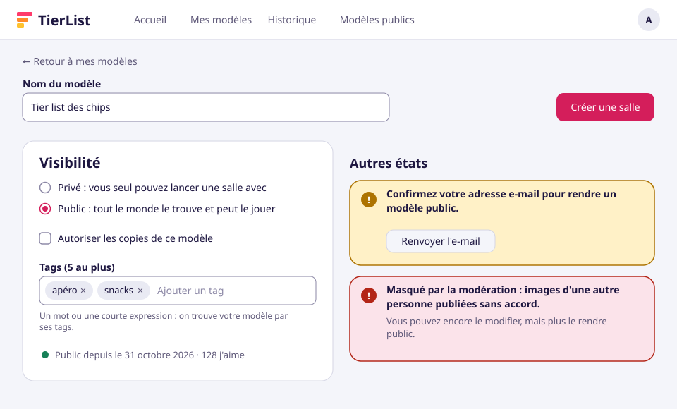
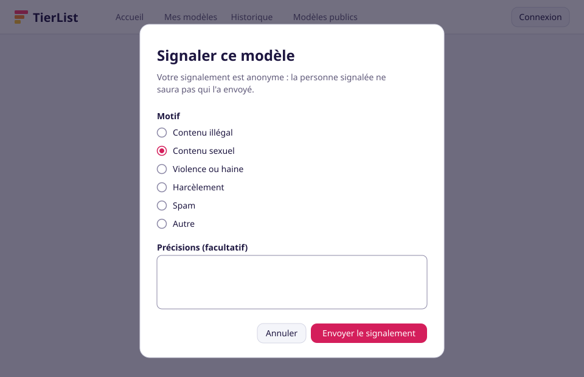
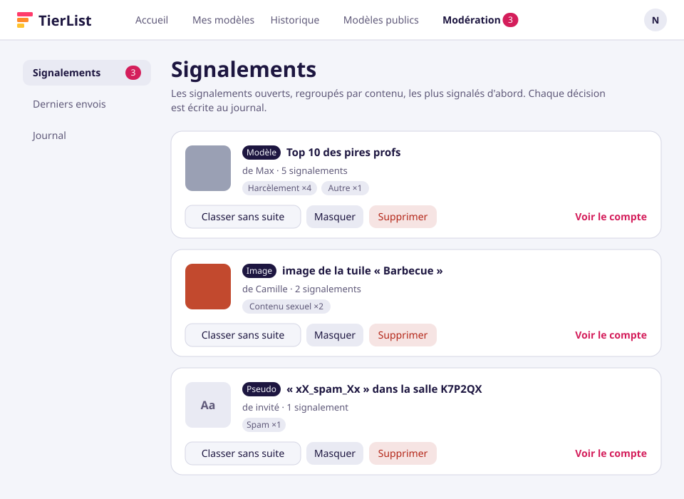
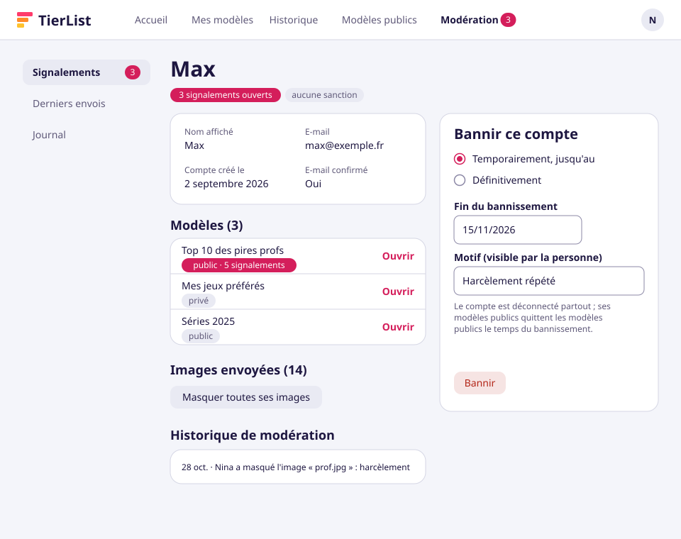
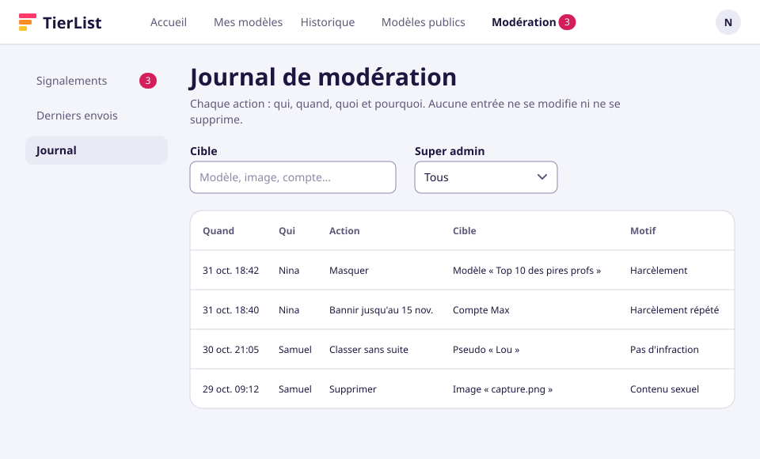
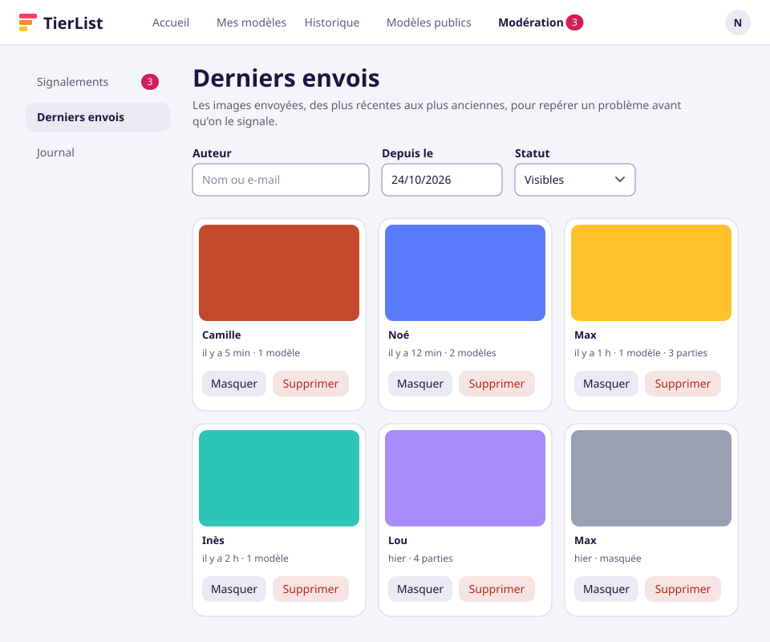

# Jalon 2 — Écrans

[English](screens.md) | Français

Les wireframes des nouveaux écrans du [jalon 2](README.fr.md), dessinés sur l'[identité visuelle](../../technical/visual-identity.fr.md) « Le Plateau ». Ils montrent **ce que contient et fait chaque écran** ; les écrans construits peuvent différer dans le détail. Stories : [user-stories.fr.md](user-stories.fr.md). Les mêmes écrans, en maquettes modifiables, sont sur le [canevas](https://claude.ai/artifact/EYMsS8K3Yj5fAjXGgj9t5d) (claude.ai, privé à son propriétaire, partagé sur demande).

Chaque image existe en français (affichée ici) et en anglais ([screens.md](screens.md)), dans [screens/](screens/).

Les images sont générées par [`scripts/screens/milestone_2.py`](../../../scripts/screens/milestone_2.py), sur le même kit de dessin que le [jalon 1](../milestone-1/screens.fr.md) : ne jamais modifier un SVG à la main, changer le script et le relancer.

```bash
uv run --project backend python scripts/screens/milestone_2.py
```

Les textes déjà dans l'interface viennent de ses traductions ; les nouveaux, validés sur les maquettes, sont écrits dans le script tant que leurs clés de traduction n'existent pas.

## 1. Modèles publics



- **Stories** : US-3.1, US-3.2, US-3.4.
- L'écran vu **par un visiteur** : pas besoin de compte pour parcourir. L'en-tête gagne un lien « Modèles publics » pour tous.
- Recherche dans le nom et les tags, filtre par tag, tri par **les plus aimés** (par défaut) ou les plus récents ; « Voir plus » charge la page suivante.
- Chaque carte : aperçu (l'image de la première tuile), nom, propriétaire, nombre d'éléments, tags et j'aime.

## 2. Page d'un modèle public



- **Stories** : US-3.3, US-2.4, US-3.4, US-3.5, US-3.7, US-1.2.
- Nom, propriétaire et **lignée** pour un fork (« copié de … par … »), tags, tiers et éléments.
- Actions : créer une salle avec, j'aime, favori, **copier dans mes modèles** (le fork, si le propriétaire l'autorise), signaler. Un visiteur est invité à se connecter pour chacune, sauf signaler.

## 3. Publier et taguer



- **Stories** : US-2.1, US-2.2, US-2.3, US-3.6, US-1.10.
- Dans l'éditeur de modèle : **privé ou public**, copies autorisées ou non (non par défaut), et jusqu'à **5 tags**.
- Autres états : un e-mail non confirmé (publication refusée, avec un lien pour renvoyer l'e-mail), et un modèle **masqué par la modération** avec son motif.

## 4. Signaler



- **Stories** : US-1.2.
- Ouvert à tous, visiteurs compris ; le signalement est **anonyme** pour la personne signalée. Le même dialogue sert pour un modèle, une image, un pseudo ou une partie.

## 5. Modération : signalements



- **Stories** : US-1.1, US-1.3.
- L'espace de modération est réservé aux super admins : un lien « Modération » avec le nombre de signalements ouverts dans l'en-tête, un menu à gauche.
- Les signalements ouverts **regroupés par contenu**, les plus signalés d'abord ; classer sans suite, masquer, supprimer, ou ouvrir le compte pour le sanctionner. Chaque décision va au journal.

## 6. Modération : un compte



- **Stories** : US-1.8.
- Informations, modèles, images envoyées (toutes masquables d'un coup) et historique de modération.
- **Bannir** temporairement (jusqu'à une date) ou définitivement, avec un motif visible par la personne.

## 7. Modération : journal



- **Stories** : US-1.9.
- Chaque action, des plus récentes aux plus anciennes, filtrée par cible ou super admin ; aucune entrée ne se modifie ni ne se supprime.

## 8. Modération : derniers envois



- **Stories** : US-1.7, US-1.4.
- Les dernières images, des plus récentes aux plus anciennes, avec leur auteur, leur date et leur usage ; filtres par auteur, date et statut ; masquer ou supprimer depuis la grille.
