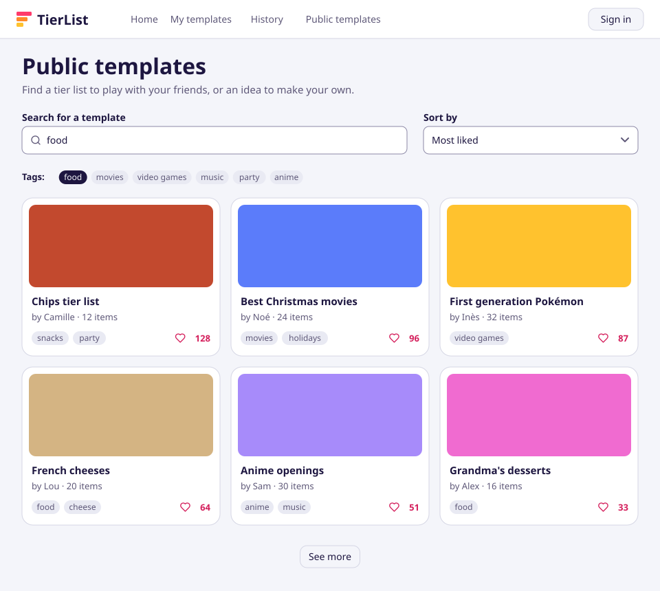
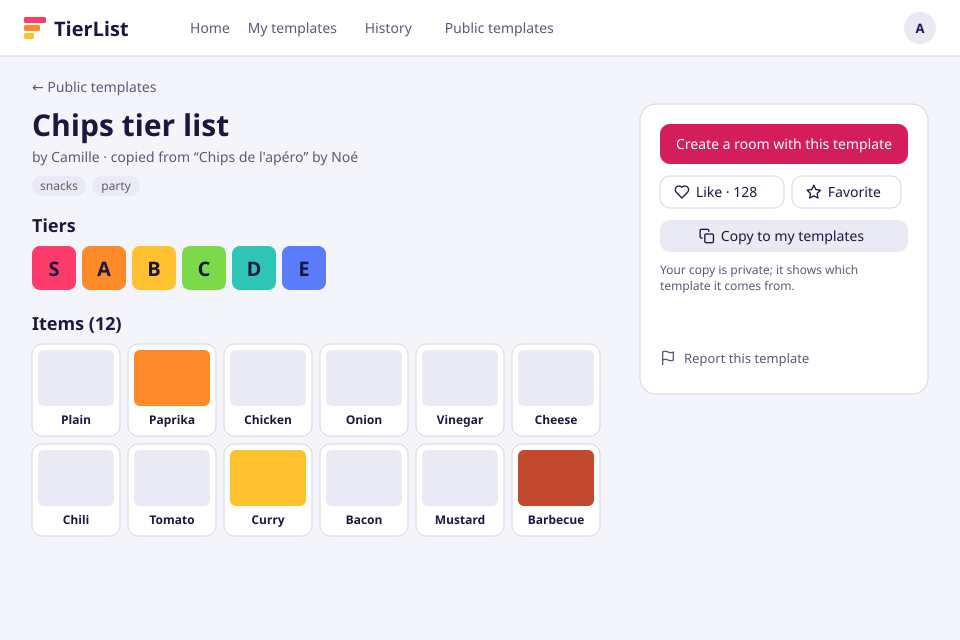
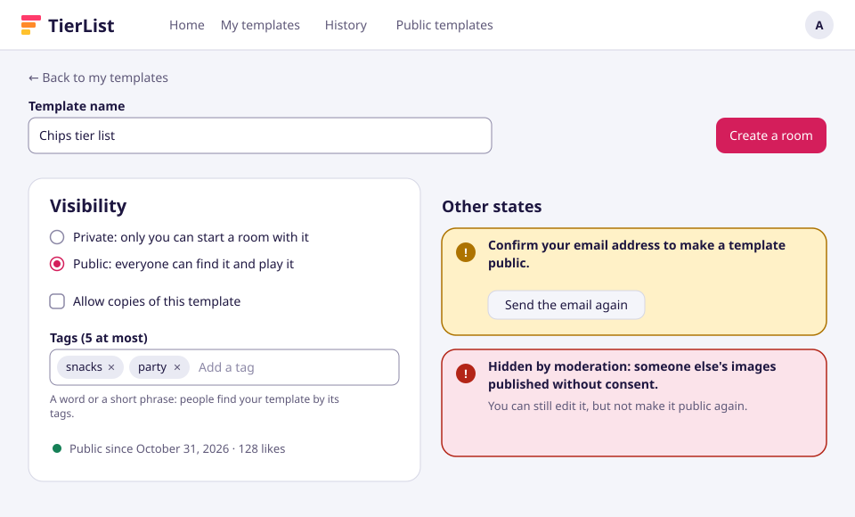
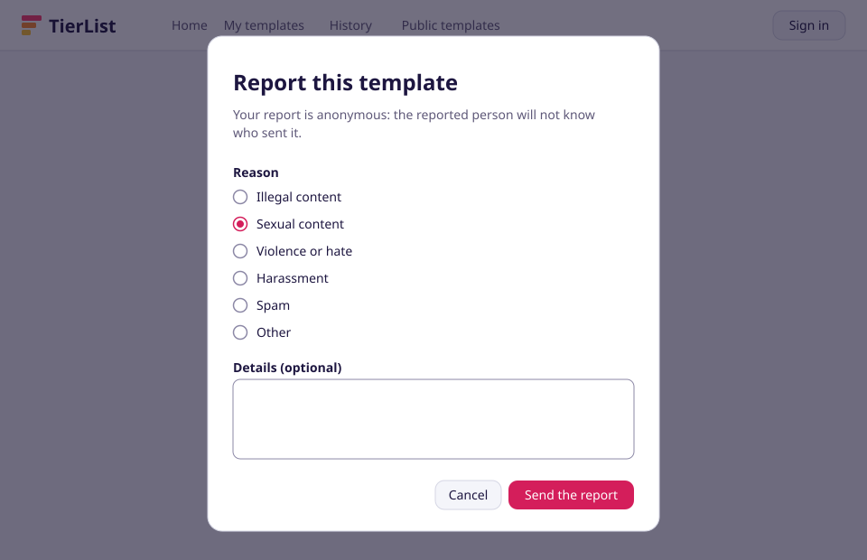
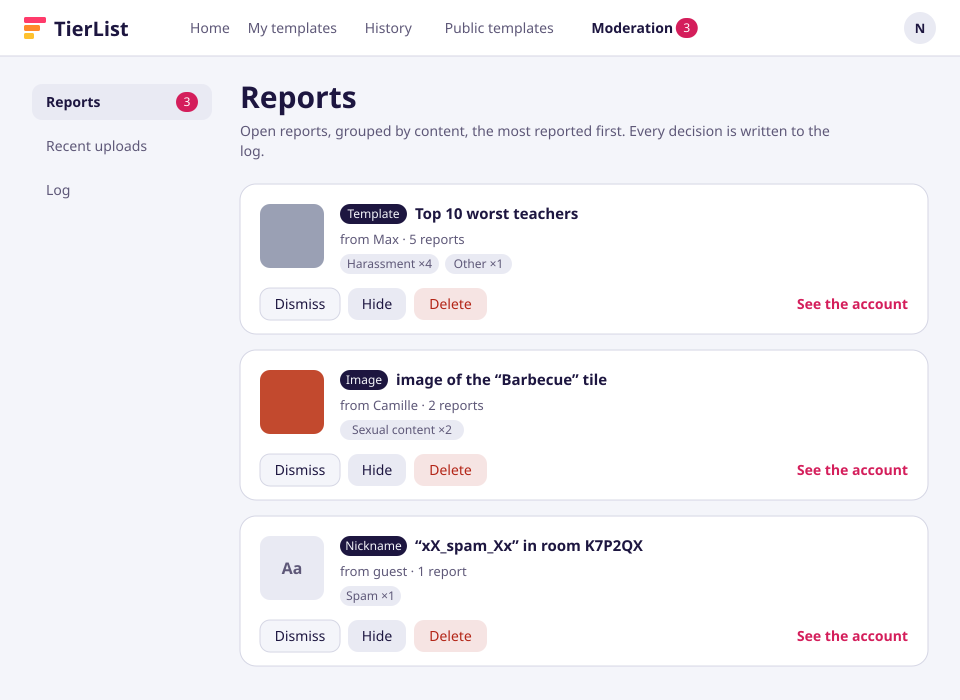
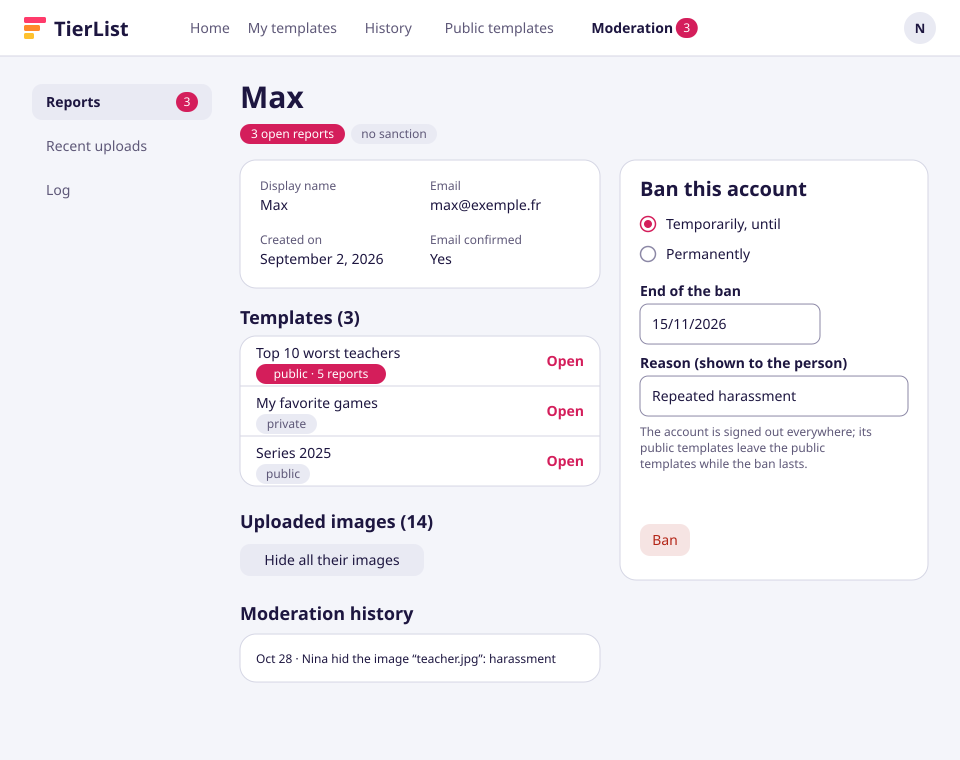
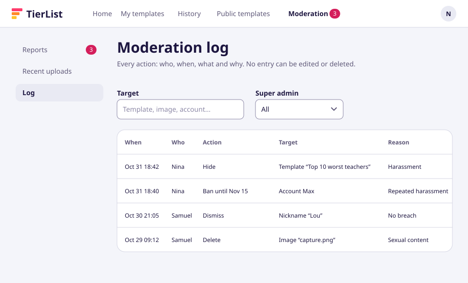
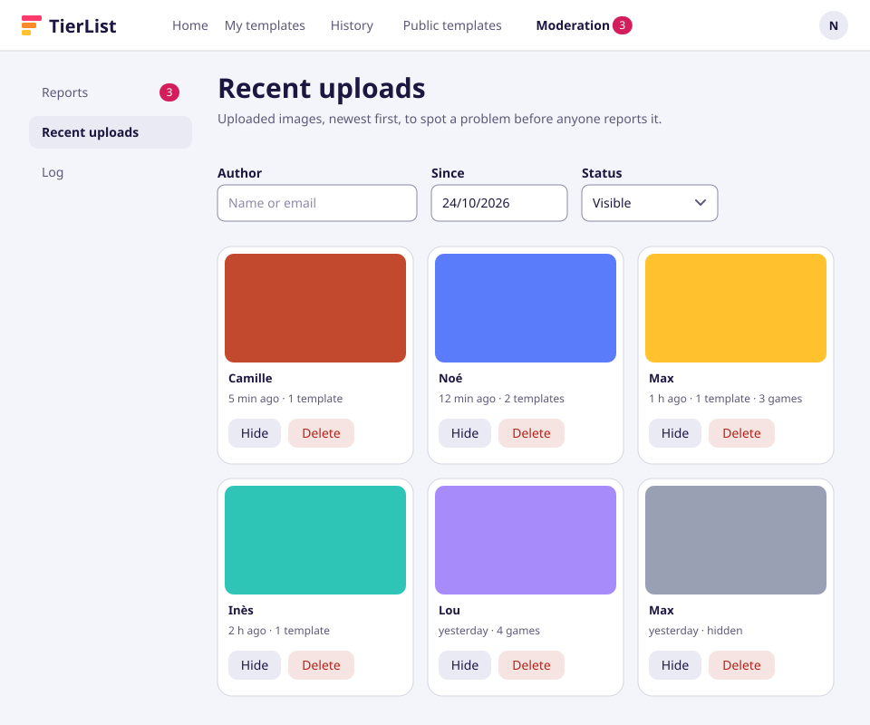

# Milestone 2 — Screens

English | [Français](screens.fr.md)

Wireframes of the new screens of [milestone 2](README.md), drawn on the [visual identity](../../technical/visual-identity.md) "Le Plateau". They show **what each screen contains and does**; the screens built can differ in details. Stories: [user-stories.md](user-stories.md). The same screens, as editable mockups, are on the [design canvas](https://claude.ai/artifact/EYMsS8K3Yj5fAjXGgj9t5d) (claude.ai, private to its owner, shared on request).

Each image exists in English (shown here) and in French ([screens.fr.md](screens.fr.md)), in [screens/](screens/).

The images are generated by [`scripts/screens/milestone_2.py`](../../../scripts/screens/milestone_2.py), on the same drawing kit as [milestone 1](../milestone-1/screens.md): never edit an SVG by hand, change the script and run it again.

```bash
uv run --project backend python scripts/screens/milestone_2.py
```

The texts already in the interface come from its translations; the new ones, validated on the mockups, are written in the script until their translation keys exist.

## 1. Public templates



- **Stories**: US-3.1, US-3.2, US-3.4.
- The screen seen **by a visitor**: no account needed to browse. The header gets a "Public templates" link for everyone.
- Search in the name and the tags, a tag filter, sort by **most liked** (default) or newest; "See more" loads the next page.
- Each card: preview (the image of the first tile), name, owner, number of items, tags and likes.

## 2. Public template page



- **Stories**: US-3.3, US-2.4, US-3.4, US-3.5, US-3.7, US-1.2.
- Name, owner and **lineage** for a fork ("copied from … by …"), tags, tiers and items.
- Actions: create a room with it, like, favorite, **copy to my templates** (the fork, when the owner allows it), report. A visitor is asked to sign in for each of them but reporting.

## 3. Publish and tag



- **Stories**: US-2.1, US-2.2, US-2.3, US-3.6, US-1.10.
- In the template editor: **private or public**, whether copies are allowed (off by default), and up to **5 tags**.
- Other states: an unconfirmed email (publishing refused, with a link to send the email again), and a template **hidden by moderation** with its reason.

## 4. Report



- **Stories**: US-1.2.
- Open to everyone, visitors included; the report is **anonymous** for the reported person. The same dialog serves a template, an image, a nickname or a game.

## 5. Moderation: reports



- **Stories**: US-1.1, US-1.3.
- The moderation area is only for super admins: a "Moderation" link with the number of open reports in the header, a menu on the left.
- Open reports **grouped by content**, the most reported first; dismiss, hide, delete, or open the account to sanction it. Every decision goes to the log.

## 6. Moderation: an account



- **Stories**: US-1.8.
- Details, templates, uploaded images (hide them all at once) and moderation history.
- **Ban** temporarily (until a date) or permanently, with a reason shown to the person.

## 7. Moderation: log



- **Stories**: US-1.9.
- Every action, newest first, filtered by target or super admin; no entry can be edited or deleted.

## 8. Moderation: recent uploads



- **Stories**: US-1.7, US-1.4.
- The latest images, newest first, with their author, date and use; filters by author, date and status; hide or delete from the grid.
