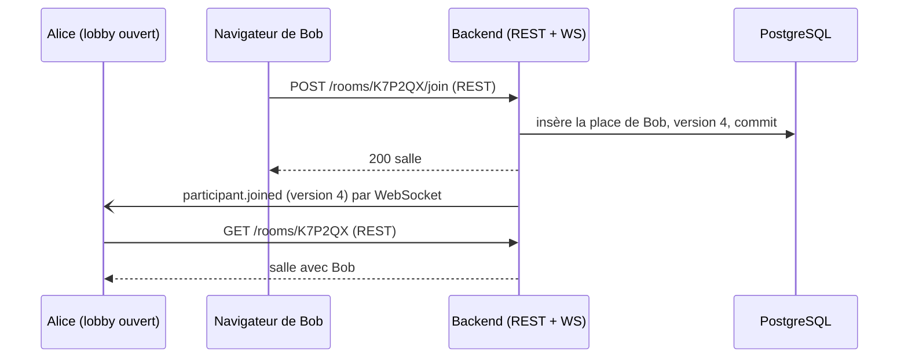

# WebSocket : fonctionnement du canal des salles

[English](websocket.md) | Français

Un guide pour qui doit corriger ou faire évoluer le canal temps réel des salles. La partie 1 explique le WebSocket en général, la partie 2 montre comment TierList l'utilise, la partie 3 fait la carte du code, la partie 4 aide à déboguer et à ajouter un événement. Les décisions de conception et leurs raisons sont dans le [guide du temps réel](realtime.fr.md) ; cette page explique comment le résultat fonctionne.

## 1. Le WebSocket en quelques minutes

### 1.1 Pourquoi un WebSocket

HTTP fonctionne en « requête, puis réponse » : le serveur ne parle que si le navigateur demande. Pour montrer un joueur qui arrive dans un lobby, le navigateur devrait redemander sans cesse (polling). Un **WebSocket** est une connexion qui reste ouverte, sur laquelle **chaque côté peut envoyer des messages à tout moment**. Le serveur peut donc pousser « Bob vient d'arriver » à l'instant où ça se produit.

### 1.2 La poignée de main

Un WebSocket commence par une requête HTTP ordinaire, qui demande à changer de protocole :

```http
GET /api/rooms/K7P2QX/ws HTTP/1.1
Host: localhost:5173
Upgrade: websocket
Connection: Upgrade
Origin: http://localhost:5173
Cookie: guest_token=…            (envoyé par le navigateur s'il correspond au chemin)
Sec-WebSocket-Key: …
```

Si le serveur accepte, il répond `101 Switching Protocols` et la connexion devient un WebSocket. S'il refuse, il répond une erreur HTTP ordinaire (TierList répond `403` pour une mauvaise origine). Trois choses à retenir :

- Le navigateur envoie automatiquement **les cookies** du chemin visé, mais il **ne peut pas ajouter d'en-tête `Authorization`**. C'est pourquoi un compte envoie son token dans le premier message (§2.3), et pourquoi un invité est reconnu par son cookie.
- Le navigateur envoie toujours un en-tête **`Origin`** : le serveur peut vérifier que la page vient de notre site.
- L'URL commence par `ws://` (ou `wss://` en HTTPS).

### 1.3 Les messages (trames)

Une fois ouverte, la connexion transporte des **trames** : trames texte (TierList y met du JSON), trames binaires (pas utilisées ici), et trames de contrôle (`ping`/`pong` du protocole, `close`). Il n'y a pas d'appariement requête/réponse : chaque côté lit les messages à mesure qu'ils arrivent.

### 1.4 La fermeture et les codes de fermeture

Chaque côté peut fermer avec un **code de fermeture** et une courte **raison** :

| Code          | Signification                                                                                                                                                                               |
| ------------- | ------------------------------------------------------------------------------------------------------------------------------------------------------------------------------------------- |
| `1000`        | Fermeture normale (par ex. la page quitte la salle)                                                                                                                                         |
| `1006`        | Fermeture anormale : la connexion est tombée sans trame de fermeture (réseau perdu, serveur tué, poignée de main refusée). Personne ne l'envoie jamais ; c'est le navigateur qui le signale |
| `1008`        | Violation de politique                                                                                                                                                                      |
| `1011`        | Erreur interne du serveur                                                                                                                                                                   |
| `4000`–`4999` | Libres pour les applications : TierList y met ses propres codes (§2.6)                                                                                                                      |

### 1.5 Détecter une connexion morte

Une connexion peut mourir en silence (wifi perdu, ordinateur en veille) : aucune trame de fermeture n'arrive, et chaque côté peut croire que l'autre est encore là. Le remède est un **battement de cœur** : un côté envoie régulièrement un message et attend une réponse dans un délai ; sans réponse, il considère la connexion morte et la ferme.

### 1.6 Se reconnecter

Un WebSocket fermé ne se rouvre pas tout seul : le client doit en créer un nouveau. La bonne pratique est un **backoff exponentiel avec gigue** : attendre 0,5 s, puis 1 s, 2 s… jusqu'à un plafond, avec une part aléatoire, pour que beaucoup de clients coupés ensemble ne reviennent pas tous au même instant.

## 2. Comment TierList l'utilise

### 2.1 Le principe : pousser seulement

Le socket sert **seulement à pousser** les événements du serveur et à savoir qui est connecté. Chaque action (rejoindre, changer les réglages, plus tard placer un item…) reste une **route REST** : elle garde la validation, les codes d'erreur et le contrat OpenAPI. Après l'action, le serveur prévient toute la salle par le socket.



Le client ne reconstruit jamais la salle à partir des événements : un événement soit modifie un petit détail (la présence), soit fait **relire la salle** par REST. La réponse REST reste la vérité.

### 2.2 Une connexion, étape par étape

```mermaid
sequenceDiagram
    participant C as Navigateur (useRoomEvents)
    participant V as Proxy Vite (dev)
    participant S as Backend (room_channel)
    C->>V: GET /api/rooms/K7P2QX/ws (Upgrade)
    V->>S: GET /rooms/K7P2QX/ws (Upgrade)
    S->>S: Origin == origine de FRONTEND_BASE_URL ?
    S-->>C: 101 Switching Protocols
    C->>S: {"type":"auth","access_token":"…" ou null}
    S->>S: token (compte) ou cookie guest_token (invité), puis place dans la salle ?
    S->>S: enregistre le socket ; premier socket de ce participant ?
    S-)C: participant.presence (connected: true) à toute la salle
    loop toutes les 10 s de silence
        S-)C: {"type":"ping"}
        C->>S: {"type":"pong"}
    end
    C--xS: onglet fermé (trame de fermeture)
    S->>S: dernier socket ? attend 3 s (délai de grâce)
    S-)C: participant.presence (connected: false) aux autres
```

### 2.3 L'authentification

Le **premier message** doit être `auth`, dans les 5 s (`ROOM_AUTH_TIMEOUT_SECONDS`) :

- **Compte** : `{"type": "auth", "access_token": "<JWT>"}`. Le serveur le vérifie comme une requête REST (`AuthService.authenticate_access_token`). Le token n'est **jamais mis dans l'URL** (il finirait dans les journaux et l'historique).
- **Invité** : `{"type": "auth", "access_token": null}`. Le navigateur a déjà envoyé le cookie `guest_token` avec la poignée de main (son chemin est `/api/rooms/<code>`, il ne part donc que vers cette salle).
- Un compte passe d'abord, comme en REST. Ensuite, le lecteur doit **avoir une place** dans la salle, sinon `4404 room_not_found` (le serveur ne révèle pas que la salle existe).

### 2.4 Les messages

Chaque événement du serveur a la même enveloppe : `{"type": "…", "room_version": 12, "data": {…}}`.

| Message                 | Sens                                | Effet côté client                                  |
| ----------------------- | ----------------------------------- | -------------------------------------------------- |
| `auth`                  | client → serveur                    | Premier message (§2.3)                             |
| `ping` / `pong`         | serveur → client / client → serveur | Battement de cœur                                  |
| `participant.joined`    | serveur → client                    | Relit la salle                                     |
| `participant.presence`  | serveur → client                    | Modifie `connected` d'un participant dans le cache |
| `participant.removed`   | serveur → client                    | Retire un participant du cache                     |
| `room.settings_updated` | serveur → client                    | Relit la salle                                     |
| `game.started`          | serveur → client                    | Relit la salle (tour 1, item en cours)             |

Les modèles sont dans `backend/app/schemas/room_events.py` et sont ajoutés au schéma OpenAPI, pour que `pnpm gen:api` génère leurs types TypeScript (`RoomServerMessage`, `RoomClientMessage` dans `frontend/src/api/schema.d.ts`).

### 2.5 La version de la salle

`rooms.version` est un entier incrémenté **dans la même transaction** que chaque changement de la salle (jonction, retrait, réglages, présence). Chaque événement la porte en `room_version`, et la salle REST la porte en `version`. Le client compare :

- `room_version == version en cache + 1` → il applique l'événement ;
- `room_version <= version en cache` → déjà dans la salle lue, il l'ignore ;
- sinon (un saut : un événement manqué, ou deux événements arrivés dans le désordre) → il relit la salle.

Le serveur ne rejoue jamais les événements passés : au moindre doute, et après chaque (re)connexion, le client relit simplement la salle.

### 2.6 Les codes de fermeture de TierList

| Code       | Raison              | Quand                                                                | Le client…                                                              |
| ---------- | ------------------- | -------------------------------------------------------------------- | ----------------------------------------------------------------------- |
| HTTP `403` | —                   | `Origin` n'est pas l'origine de `FRONTEND_BASE_URL`                  | voit `1006` ; après 5 échecs d'affilée, abandonne et affiche un message |
| `4400`     | `invalid_message`   | Pas `auth` d'abord, puis pas `pong` ; ou une trame binaire           | se reconnecte                                                           |
| `4401`     | `not_authenticated` | Pas d'`auth` à temps, token invalide, ou ni token ni cookie d'invité | un compte réessaie **une fois** avec un token rafraîchi, puis s'arrête  |
| `4404`     | `room_not_found`    | Salle inconnue, ou pas de place dedans                               | s'arrête                                                                |
| `4408`     | `heartbeat_timeout` | Pas de `pong` dans les 5 s après un ping                             | se reconnecte                                                           |
| `4410`     | `removed_from_room` | Le room admin a retiré le participant                                | s'arrête ; la page le dit et propose de revenir                         |
| `4411`     | `room_banned`       | Le room admin a banni le participant                                 | s'arrête ; la page le dit                                               |

### 2.7 La présence

- Un participant est **connecté** tant qu'au moins un de ses onglets a son socket ouvert.
- Quand son **dernier** socket se ferme, le serveur attend un **délai de grâce** (3 s) avant de le marquer déconnecté : un rechargement de page (moins de 2 s) ne le fait pas clignoter hors ligne.
- `participants.connected` n'est écrit que s'il change, et chaque changement est publié (`participant.presence`).
- Au démarrage, le backend remet tout le monde à déconnecté : un processus qui démarre n'a aucun socket ouvert.

| Réglage                           | Défaut | Rôle                                                        |
| --------------------------------- | ------ | ----------------------------------------------------------- |
| `ROOM_HEARTBEAT_INTERVAL_SECONDS` | `10`   | Ping après ce silence du client                             |
| `ROOM_HEARTBEAT_TIMEOUT_SECONDS`  | `5`    | Socket fermé sans pong dans ce délai                        |
| `ROOM_PRESENCE_GRACE_SECONDS`     | `3`    | Délai avant « déconnecté » une fois le dernier socket fermé |
| `ROOM_AUTH_TIMEOUT_SECONDS`       | `5`    | Délai du message `auth`                                     |

Délais de départ en pratique : un onglet fermé apparaît hors ligne au bout de 3 s environ ; une coupure réseau brutale au bout de 18 s au plus (10 s de silence + 5 s sans pong + 3 s de grâce).

### 2.8 Code synchrone et code asynchrone

C'est la partie subtile du backend :

- Les routes REST et SQLAlchemy sont **synchrones** : FastAPI les exécute dans un **threadpool**.
- La route WebSocket est **asynchrone** : elle tourne dans la **boucle d'événements** (asyncio), qui ne doit jamais être bloquée.

Deux conséquences :

1. Depuis la route WebSocket, chaque appel à la base passe par `run_in_threadpool`, avec une **session courte** ouverte par `get_session_factory` (le socket vit longtemps ; il ne doit pas garder une connexion à la base).
2. Une route REST (dans un thread) qui publie un événement ne peut pas écrire directement sur un socket : `ConnectionRegistry.publish` confie la diffusion à la boucle avec `loop.call_soon_threadsafe`. Le registre lui-même n'est modifié que dans la boucle.

### 2.9 Le registre des connexions

`ConnectionRegistry` (`backend/app/services/room_channel.py`) garde **en mémoire** les sockets ouverts de ce processus par salle, avec le participant de chaque socket. Il sait si un socket est le premier ou le dernier d'un participant, diffuse les événements d'une salle, garde les départs en attente (délai de grâce), et ferme les sockets d'un participant retiré par le room admin (`disconnect_participant`, appelé depuis le threadpool comme `publish`). Ces sockets quittent le registre avant d'être fermés : leur route ne programme alors aucun départ, et ils ne reçoivent plus aucun événement.

Comme il est en mémoire, **le backend doit tourner avec un seul worker** : avec plusieurs processus, le socket d'Alice et la requête REST de Bob pourraient arriver dans des processus différents, et Alice ne saurait jamais que Bob est arrivé. Le partage des événements entre processus (PostgreSQL `LISTEN/NOTIFY`, puis Redis) est décrit dans le [guide du temps réel](realtime.fr.md#29-montée-en-charge).

### 2.10 Le frontend

`useRoomEvents(code, viewer, enabled, onRemoved)` (`frontend/src/api/roomChannel.ts`) possède le socket ; les composants n'y touchent jamais. `RoomPage` l'active une fois la salle chargée (le lecteur a une place). Il :

- ouvre `ws(s)://<hôte de la page>/api/rooms/<CODE>/ws` et envoie `auth` (l'access token en mémoire, rafraîchi s'il manque ; `null` pour un invité) ;
- répond `pong` au `ping` ;
- applique les événements au cache TanStack Query (§2.5) ;
- relit la salle après chaque (re)connexion ;
- après `4410` ou `4411`, appelle `onRemoved(banned)` et s'arrête : `RoomPage` affiche le message et ne lit plus la salle ;
- se reconnecte avec backoff et gigue (0,5 s à 10 s), pas après `4404` ; après `4401`, un compte réessaie une fois avec un token rafraîchi (l'access token dure 15 minutes) ;
- abandonne après 5 ouvertures d'affilée qui n'ont jamais abouti, et renvoie `unavailable: true` (le lobby affiche alors « Mises à jour en direct indisponibles : rechargez la page ») ;
- ferme le socket (`1000`) quand la page quitte la salle.

En développement, le proxy Vite transmet le socket (`ws: true` dans `frontend/vite.config.ts`) : le navigateur ouvre `/api/rooms/…/ws` sur le port 5173, Vite le transmet à `/rooms/…/ws` sur le port 8000.

## 3. Dans le code

| Fichier                                                       | Ce qu'il faut y regarder                                                                                                                                                                                                        |
| ------------------------------------------------------------- | ------------------------------------------------------------------------------------------------------------------------------------------------------------------------------------------------------------------------------- |
| `backend/app/api/routes/room_channel.py`                      | La route WebSocket : contrôle de l'origine, `_receive_auth`, `_find_seat`, `_serve` (enregistrement et présence), `_heartbeat`, `_receive_text` (refuse les trames binaires), `ChannelClosedError` (code + raison de fermeture) |
| `backend/app/services/room_channel.py`                        | `RoomEventPublisher` (ce qu'appellent les services) et `ConnectionRegistry` (`room_connections`) : sockets, `publish`, `schedule_disconnect`, `disconnect_participant`                                                          |
| `backend/app/services/rooms.py`                               | Les changements de la salle qui publient après le commit (`join`, `join_as_guest`, `update_settings`, `remove_participant`), `seat_of`, `set_presence`, `reset_presence`                                                        |
| `backend/app/schemas/room_events.py`                          | Modèles des événements et des messages                                                                                                                                                                                          |
| `backend/app/constants/rooms.py`                              | Codes de fermeture (`CHANNEL_CLOSE_*`), cookie d'invité                                                                                                                                                                         |
| `backend/app/core/config.py`                                  | Les quatre durées, `app_origin`                                                                                                                                                                                                 |
| `backend/app/api/dependencies.py`                             | `get_connection_registry`, `get_room_event_publisher`, `get_session_factory`                                                                                                                                                    |
| `backend/app/main.py`                                         | Lifespan (remise à zéro de la présence), schémas des messages ajoutés à OpenAPI                                                                                                                                                 |
| `frontend/src/api/roomChannel.ts`                             | `useRoomEvents`, `applyRoomEvent`                                                                                                                                                                                               |
| `frontend/src/components/RoomLobby.tsx`, `pages/RoomPage.tsx` | Pastille de présence, message « mises à jour en direct indisponibles », message de retrait ou de bannissement                                                                                                                   |
| `frontend/vite.config.ts`                                     | `ws: true`                                                                                                                                                                                                                      |

Tests : `backend/tests/integration/test_room_channel.py` (route), `backend/tests/test_room_connections.py` (registre), tests de publication dans `test_rooms.py` / `test_room_guests.py` / `test_room_removal.py`, `frontend/src/api/roomChannel.test.ts` avec le faux socket `frontend/src/test/fakeWebSocket.ts`. Tous sont décrits dans le [guide des tests](testing.fr.md).

## 4. Déboguer et faire évoluer

### 4.1 Observer le canal dans le navigateur

Outils de développement → **Réseau** → filtre **WS** → cliquer sur la requête `ws` → onglet **Messages** : chaque trame, dans les deux sens, avec le code de fermeture à la fin. L'onglet **En-têtes** montre la poignée de main (`101`, ou le refus).

### 4.2 Symptômes fréquents

| Symptôme                                                                 | Cause probable                                                                                                                                                | Où regarder                                                                                                    |
| ------------------------------------------------------------------------ | ------------------------------------------------------------------------------------------------------------------------------------------------------------- | -------------------------------------------------------------------------------------------------------------- |
| « Mises à jour en direct indisponibles » tout de suite, `1006` en boucle | Origine refusée : l'application est ouverte à `http://127.0.0.1:5173` au lieu de `http://localhost:5173` (ou `FRONTEND_BASE_URL` diffère de l'adresse réelle) | Journal du backend `Canal refusé, origine inattendue` ; `FRONTEND_BASE_URL`                                    |
| Même symptôme, aucun journal côté backend                                | Backend arrêté, ou proxy sans `ws: true`                                                                                                                      | `frontend/vite.config.ts` ; le backend tourne-t-il sur le port 8000 ?                                          |
| Fermé avec `4401`                                                        | Pas d'`auth` envoyé à temps, token expiré qui n'a pas pu être rafraîchi, invité sans cookie                                                                   | L'onglet **Messages** : `auth` est-il la première trame ? Le cookie `guest_token` (chemin `/api/rooms/<CODE>`) |
| Fermé avec `4404`                                                        | Le lecteur n'a pas de place dans cette salle (ou le code est faux)                                                                                            | `GET /rooms/<code>` répond `404` aussi                                                                         |
| Fermé avec `4408`                                                        | Le client n'a pas répondu `pong` (onglet figé, débogueur en pause)                                                                                            | Durées dans `.env`                                                                                             |
| Le lobby ne se met pas à jour, socket ouvert                             | Événement non publié, ou publié avant le commit                                                                                                               | Le service : `self._publisher.publish(...)` est-il appelé **après** `self._session.commit()` ?                 |
| Quelqu'un reste « en ligne » après être parti                            | Socket pas fermé (connexion morte) : attendre le battement de cœur ; ou plusieurs workers backend                                                             | Un seul worker obligatoire (§2.9)                                                                              |
| Un rechargement fait clignoter quelqu'un hors ligne                      | Rechargement plus lent que le délai de grâce                                                                                                                  | `ROOM_PRESENCE_GRACE_SECONDS`                                                                                  |

### 4.3 Tester à la main sans navigateur

Un petit script Python (le paquet `websockets` vient avec les dépendances du backend) peut ouvrir le canal à travers le proxy :

```python
import asyncio, json, websockets

async def main():
    async with websockets.connect(
        "ws://127.0.0.1:5173/api/rooms/K7P2QX/ws", origin="http://localhost:5173"
    ) as socket:
        await socket.send(json.dumps({"type": "auth", "access_token": "<token>"}))
        while True:
            print(await socket.recv())

asyncio.run(main())
```

### 4.4 Ajouter un événement

1. **Modèle** : dans `backend/app/schemas/room_events.py`, ajouter un modèle `…Data` et un modèle `…Event` avec un `type` unique (`sujet.événement`, en minuscules) et `room_version`, puis ajouter l'événement à `RoomEvent` et à `RoomServerMessage`.
2. **Publier** : dans le service qui fait le changement, incrémenter `room.version`, faire le commit, **puis** appeler `self._publisher.publish(room.id, VotreEvenement(room_version=room.version, data=…))`. Ne jamais publier avant le commit (le client pourrait relire la salle avant que le changement soit visible).
3. **Contrat** : `uv run python scripts/export_openapi.py` (backend), puis `pnpm gen:api` (frontend).
4. **Client** : dans `applyRoomEvent` (`frontend/src/api/roomChannel.ts`), soit modifier le cache (petit changement qui se suffit à lui-même), soit laisser le cas par défaut « relire la salle ».
5. **Tests** : un test REST avec la fixture `room_events` (l'événement et sa version), un test du canal si le comportement du socket change, un test dans `roomChannel.test.ts` si le client le traite à part ; mettre à jour le [guide des tests](testing.fr.md) et cette page.

### 4.5 Règles à ne pas casser

- Les actions restent en REST ; le socket ne fait que pousser.
- Publier **après** le commit, avec la version incrémentée dans la même transaction.
- Ne jamais mettre le token dans l'URL ; garder le contrôle de l'origine (sinon le cookie d'invité permettrait à un autre site d'ouvrir le canal).
- Ne pas bloquer la boucle d'événements : les appels à la base de la route passent par `run_in_threadpool`.
- Un seul worker backend tant que le registre est en mémoire.
