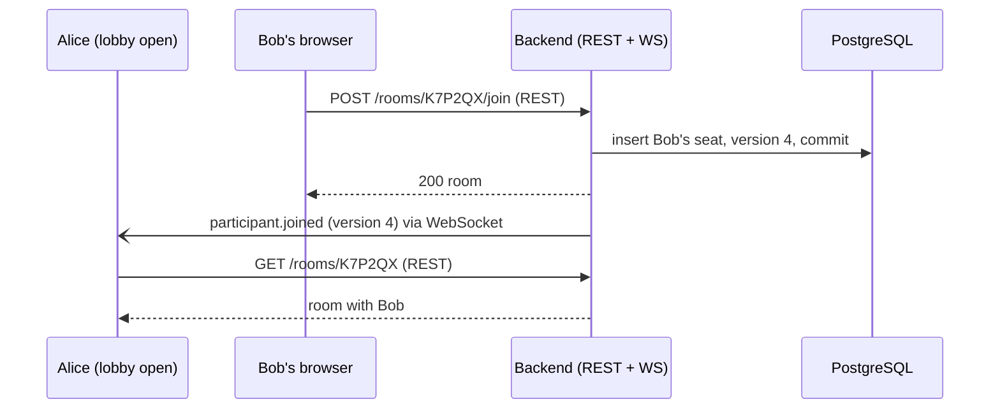

# WebSocket: how the room channel works

English | [Français](websocket.fr.md)

A guide for whoever has to fix or extend the real-time channel of the rooms. Part 1 explains WebSocket in general, part 2 shows how TierList uses it, part 3 maps the code, part 4 helps to debug and to add an event. The design decisions and their reasons are in the [real-time guide](realtime.md); this page explains how the result works.

## 1. WebSocket in a few minutes

### 1.1 Why WebSocket

HTTP is "request, then response": the server only speaks when the browser asks. To show a player who arrives in a lobby, the browser would have to ask again and again (polling). A **WebSocket** is a connection that stays open, on which **both sides can send messages at any time**. The server can therefore push "Bob just joined" the moment it happens.

### 1.2 The handshake

A WebSocket starts as an ordinary HTTP request, which asks to switch protocol:

```http
GET /api/rooms/K7P2QX/ws HTTP/1.1
Host: localhost:5173
Upgrade: websocket
Connection: Upgrade
Origin: http://localhost:5173
Cookie: guest_token=…            (sent by the browser if one matches the path)
Sec-WebSocket-Key: …
```

If the server accepts, it answers `101 Switching Protocols` and the connection becomes a WebSocket. If it refuses, it answers an ordinary HTTP error (TierList answers `403` for a wrong origin). Three things to remember:

- The browser sends **the cookies** of the target path automatically, but it **cannot add an `Authorization` header**. That is why an account sends its token in the first message (§2.3), and why a guest is recognised by its cookie.
- The browser always sends an **`Origin`** header: the server can check that the page comes from our site.
- The URL starts with `ws://` (or `wss://` over HTTPS).

### 1.3 Messages (frames)

Once open, the connection carries **frames**: text frames (TierList sends JSON in them), binary frames (not used here), and control frames (`ping`/`pong` of the protocol, `close`). There is no request/response pairing: each side reads the messages as they come.

### 1.4 Closing and close codes

Either side can close with a **close code** and a short **reason**:

| Code          | Meaning                                                                                                                                                             |
| ------------- | ------------------------------------------------------------------------------------------------------------------------------------------------------------------- |
| `1000`        | Normal closure (e.g. the page leaves the room)                                                                                                                      |
| `1006`        | Abnormal closure: the connection dropped without a close frame (network loss, server killed, handshake refused). It is never sent by anyone; the browser reports it |
| `1008`        | Policy violation                                                                                                                                                    |
| `1011`        | Internal error of the server                                                                                                                                        |
| `4000`–`4999` | Free for applications: TierList puts its own codes there (§2.6)                                                                                                     |

### 1.5 Detecting a dead connection

A connection can die silently (Wi-Fi lost, laptop asleep): no close frame arrives, and each side may believe the other is still there. The cure is a **heartbeat**: one side regularly sends a message and expects an answer within a delay; without answer, it considers the connection dead and closes it.

### 1.6 Reconnecting

A closed WebSocket does not reopen by itself: the client must create a new one. Good practice is an **exponential backoff with jitter**: wait 0.5 s, then 1 s, 2 s… up to a ceiling, with a random part, so that many clients cut off together do not all come back at the same instant.

## 2. How TierList uses it

### 2.1 The principle: push only

The socket is used **only to push** events from the server and to know who is connected. Every action (join, change the settings, later place an item…) stays a **REST route**: it keeps validation, error codes and the OpenAPI contract. After the action, the server tells everyone in the room through the socket.



The client never builds the room from the events: an event either patches a small detail (presence) or makes the client **read the room again** through REST. The REST answer stays the truth.

### 2.2 One connection, step by step

```mermaid
sequenceDiagram
    participant C as Browser (useRoomEvents)
    participant V as Vite proxy (dev)
    participant S as Backend (room_channel)
    C->>V: GET /api/rooms/K7P2QX/ws (Upgrade)
    V->>S: GET /rooms/K7P2QX/ws (Upgrade)
    S->>S: Origin == FRONTEND_BASE_URL origin?
    S-->>C: 101 Switching Protocols
    C->>S: {"type":"auth","access_token":"…" or null}
    S->>S: token (account) or guest_token cookie (guest), then seat in the room?
    S->>S: register the socket; first socket of this participant?
    S-)C: participant.presence (connected: true) to the whole room
    loop every 10 s of silence
        S-)C: {"type":"ping"}
        C->>S: {"type":"pong"}
    end
    C--xS: tab closed (close frame)
    S->>S: last socket? wait 3 s (grace delay)
    S-)C: participant.presence (connected: false) to the others
```

### 2.3 Authentication

The **first message** must be `auth`, within 5 s (`ROOM_AUTH_TIMEOUT_SECONDS`):

- **Account**: `{"type": "auth", "access_token": "<JWT>"}`. The server checks it like a REST request (`AuthService.authenticate_access_token`). The token is **never put in the URL** (it would end up in logs and history).
- **Guest**: `{"type": "auth", "access_token": null}`. The browser already sent the `guest_token` cookie with the handshake (its path is `/api/rooms/<code>`, so it only goes to that room).
- An account comes first, like in REST. Then the reader must **hold a seat** in the room, otherwise `4404 room_not_found` (the server does not reveal that the room exists).

### 2.4 Messages

Every server event has the same envelope: `{"type": "…", "room_version": 12, "data": {…}}`.

| Message                 | Direction                         | Effect on the client                                |
| ----------------------- | --------------------------------- | --------------------------------------------------- |
| `auth`                  | client → server                   | First message (§2.3)                                |
| `ping` / `pong`         | server → client / client → server | Heartbeat                                           |
| `participant.joined`    | server → client                   | Reads the room again                                |
| `participant.presence`  | server → client                   | Patches `connected` of one participant in the cache |
| `participant.removed`   | server → client                   | Removes one participant from the cache              |
| `room.settings_updated` | server → client                   | Reads the room again                                |
| `game.started`          | server → client                   | Reads the room again (round 1, current item)        |

The models live in `backend/app/schemas/room_events.py` and are added to the OpenAPI schema, so that `pnpm gen:api` generates their TypeScript types (`RoomServerMessage`, `RoomClientMessage` in `frontend/src/api/schema.d.ts`).

### 2.5 The room version

`rooms.version` is an integer incremented **in the same transaction** as each change of the room (join, removal, settings, presence). Each event carries it as `room_version`, and the REST room carries it as `version`. The client compares:

- `room_version == cached version + 1` → apply the event;
- `room_version <= cached version` → already in the room read, ignore;
- otherwise (a gap: an event was missed, or two events arrived out of order) → read the room again.

The server never replays past events: after any doubt, and after every (re)connection, the client simply reads the room again.

### 2.6 Close codes of TierList

| Code       | Reason              | When                                                                | The client…                                                            |
| ---------- | ------------------- | ------------------------------------------------------------------- | ---------------------------------------------------------------------- |
| HTTP `403` | —                   | `Origin` is not the origin of `FRONTEND_BASE_URL`                   | sees `1006`; after 5 failures in a row it gives up and shows a message |
| `4400`     | `invalid_message`   | Not `auth` first, then not `pong`; or a binary frame                | reconnects                                                             |
| `4401`     | `not_authenticated` | No `auth` in time, invalid token, or neither token nor guest cookie | an account retries **once** with a refreshed token, then stops         |
| `4404`     | `room_not_found`    | Unknown room, or no seat in it                                      | stops                                                                  |
| `4408`     | `heartbeat_timeout` | No `pong` within 5 s after a ping                                   | reconnects                                                             |
| `4410`     | `removed_from_room` | The room admin removed the participant                              | stops; the page says so and offers to go back                          |
| `4411`     | `room_banned`       | The room admin banned the participant                               | stops; the page says so                                                |

### 2.7 Presence

- A participant is **connected** as long as at least one of their tabs has its socket open.
- When their **last** socket closes, the server waits a **grace delay** (3 s) before marking them disconnected: a page reload (under 2 s) does not make them blink offline.
- `participants.connected` is written only when it changes, and each change is published (`participant.presence`).
- At startup, the backend sets everyone back to disconnected: a process that starts has no open socket.

| Setting                           | Default | Role                                                    |
| --------------------------------- | ------- | ------------------------------------------------------- |
| `ROOM_HEARTBEAT_INTERVAL_SECONDS` | `10`    | Ping after this silence of the client                   |
| `ROOM_HEARTBEAT_TIMEOUT_SECONDS`  | `5`     | Socket closed without pong within this delay            |
| `ROOM_PRESENCE_GRACE_SECONDS`     | `3`     | Delay before "disconnected" once the last socket closed |
| `ROOM_AUTH_TIMEOUT_SECONDS`       | `5`     | Delay of the `auth` message                             |

Departure delays in practice: a closed tab shows offline after about 3 s; an abrupt network loss after at most 18 s (10 s of silence + 5 s without pong + 3 s of grace).

### 2.8 Sync code and async code

This is the subtle part of the backend:

- The REST routes and SQLAlchemy are **synchronous**: FastAPI runs them in a **threadpool**.
- The WebSocket route is **asynchronous**: it runs in the **event loop** (asyncio), which must never be blocked.

Two consequences:

1. From the WebSocket route, every database call goes through `run_in_threadpool`, with a **short session** opened by `get_session_factory` (the socket lives long; it must not hold a database connection).
2. A REST route (in a thread) that publishes an event cannot write to a socket directly: `ConnectionRegistry.publish` hands the broadcast over to the loop with `loop.call_soon_threadsafe`. The registry itself is only modified inside the loop.

### 2.9 The connection registry

`ConnectionRegistry` (`backend/app/services/room_channel.py`) keeps, **in memory**, the open sockets of this process per room, with the participant of each socket. It knows whether a socket is the first or the last one of a participant, broadcasts the events of a room, holds the pending disconnections (grace delay), and closes the sockets of a participant the room admin removed (`disconnect_participant`, called from the threadpool like `publish`). Those sockets leave the registry before being closed: their route then schedules no departure, and they receive no further event.

Because it is in memory, **the backend must run with one worker**: with several processes, Alice's socket and Bob's REST request could land in different processes, and Alice would never hear about Bob. Sharing events between processes (PostgreSQL `LISTEN/NOTIFY`, then Redis) is described in the [real-time guide](realtime.md#29-scaling).

### 2.10 The frontend

`useRoomEvents(code, viewer, enabled, onRemoved)` (`frontend/src/api/roomChannel.ts`) owns the socket; components never touch it. It is enabled by `RoomPage` once the room is loaded (the reader has a seat). It:

- opens `ws(s)://<page host>/api/rooms/<CODE>/ws` and sends `auth` (the in-memory access token, refreshed if missing; `null` for a guest);
- answers `pong` to `ping`;
- applies the events to the TanStack Query cache (§2.5);
- reads the room again after each (re)connection;
- after `4410` or `4411`, calls `onRemoved(banned)` and stops: `RoomPage` shows the message and stops reading the room;
- reconnects with backoff and jitter (0.5 s to 10 s), not after `4404`; after `4401`, an account retries once with a refreshed token (the access token lasts 15 minutes);
- gives up after 5 openings in a row that never opened, and returns `unavailable: true` (the lobby then shows "Live updates are unavailable: reload the page");
- closes the socket (`1000`) when the page leaves the room.

In development, the Vite proxy forwards the socket (`ws: true` in `frontend/vite.config.ts`): the browser opens `/api/rooms/…/ws` on port 5173, Vite forwards it to `/rooms/…/ws` on port 8000.

## 3. In the code

| File                                                          | What to look at                                                                                                                                                                                                                         |
| ------------------------------------------------------------- | --------------------------------------------------------------------------------------------------------------------------------------------------------------------------------------------------------------------------------------- |
| `backend/app/api/routes/room_channel.py`                      | The WebSocket route: origin check, `_receive_auth`, `_find_seat`, `_serve` (registration and presence), `_heartbeat`, `_receive_text` (rejects binary frames); raises `ChannelClosedError` (`exceptions/rooms.py`: close code + reason) |
| `backend/app/services/room_channel.py`                        | `RoomEventPublisher` (what the services call) and `ConnectionRegistry` (`room_connections`): sockets, `publish`, `schedule_disconnect`, `disconnect_participant`                                                                        |
| `backend/app/services/rooms.py`                               | Changes of the room that publish after the commit (`join`, `join_as_guest`, `update_settings`, `remove_participant`), `seat_of`, `set_presence`, `reset_presence`                                                                       |
| `backend/app/schemas/room_events.py`                          | Event and message models                                                                                                                                                                                                                |
| `backend/app/constants/rooms.py`                              | Close codes (`CHANNEL_CLOSE_*`), guest cookie                                                                                                                                                                                           |
| `backend/app/core/config.py`                                  | The four timings, `app_origin`                                                                                                                                                                                                          |
| `backend/app/api/dependencies.py`                             | `get_connection_registry`, `get_room_event_publisher`, `get_session_factory`                                                                                                                                                            |
| `backend/app/main.py`                                         | Lifespan (presence reset), message schemas added to OpenAPI                                                                                                                                                                             |
| `frontend/src/api/roomChannel.ts`                             | `useRoomEvents`, `applyRoomEvent`                                                                                                                                                                                                       |
| `frontend/src/components/RoomLobby.tsx`, `pages/RoomPage.tsx` | Presence dot, "live updates unavailable" message, removed or banned message                                                                                                                                                             |
| `frontend/vite.config.ts`                                     | `ws: true`                                                                                                                                                                                                                              |

Tests: `backend/tests/integration/test_room_channel.py` (route), `backend/tests/test_room_connections.py` (registry), publication tests in `test_rooms.py` / `test_room_guests.py` / `test_room_removal.py`, `frontend/src/api/roomChannel.test.ts` with the fake socket `frontend/src/test/fakeWebSocket.ts`. All are described in the [testing guide](testing.md).

## 4. Debugging and changing it

### 4.1 Watching the channel in the browser

Developer tools → **Network** → filter **WS** → click the `ws` request → **Messages** tab: every frame, in both directions, with the close code at the end. The **Headers** tab shows the handshake (`101`, or the refusal).

### 4.2 Common symptoms

| Symptom                                                     | Likely cause                                                                                                                                         | Where to look                                                                                        |
| ----------------------------------------------------------- | ---------------------------------------------------------------------------------------------------------------------------------------------------- | ---------------------------------------------------------------------------------------------------- |
| "Live updates are unavailable" right away, `1006` in a loop | Origin refused: the app is open at `http://127.0.0.1:5173` instead of `http://localhost:5173` (or `FRONTEND_BASE_URL` differs from the real address) | Backend log `Canal refusé, origine inattendue`; `FRONTEND_BASE_URL`                                  |
| Same symptom, no backend log                                | Backend not running, or proxy without `ws: true`                                                                                                     | `frontend/vite.config.ts`; is the backend on port 8000?                                              |
| Closed with `4401`                                          | No `auth` sent in time, expired token that could not be refreshed, guest without cookie                                                              | The **Messages** tab: is `auth` the first frame? The `guest_token` cookie (path `/api/rooms/<CODE>`) |
| Closed with `4404`                                          | The reader has no seat in this room (or the code is wrong)                                                                                           | `GET /rooms/<code>` answers `404` too                                                                |
| Closed with `4408`                                          | The client did not answer `pong` (tab frozen, debugger paused)                                                                                       | Timings in `.env`                                                                                    |
| Lobby does not update, socket open                          | Event not published, or published before the commit                                                                                                  | The service: is `self._publisher.publish(...)` called **after** `self._session.commit()`?            |
| Someone stays "online" after leaving                        | Socket not closed (dead connection): wait for the heartbeat; or several backend workers                                                              | Must run with one worker (§2.9)                                                                      |
| A reload makes someone blink offline                        | Reload slower than the grace delay                                                                                                                   | `ROOM_PRESENCE_GRACE_SECONDS`                                                                        |

### 4.3 Testing by hand without a browser

A small Python script (the `websockets` package comes with the backend dependencies) can open the channel through the proxy:

```python
import asyncio, json, websockets

async def main():
    async with websockets.connect(
        "ws://127.0.0.1:5173/api/rooms/K7P2QX/ws", origin="http://localhost:5173"
    ) as socket:
        await socket.send(json.dumps({"type": "auth", "access_token": "<token>"}))
        while True:
            print(await socket.recv())

asyncio.run(main())
```

### 4.4 Adding an event

1. **Model**: in `backend/app/schemas/room_events.py`, add a `…Data` and a `…Event` model with a unique `type` (`subject.event`, lowercase) and `room_version`, then add the event to `RoomEvent` and `RoomServerMessage`.
2. **Publish**: in the service that makes the change, increment `room.version`, commit, **then** call `self._publisher.publish(room.id, YourEvent(room_version=room.version, data=…))`. Never publish before the commit (the client could read the room before the change is visible).
3. **Contract**: `uv run python scripts/export_openapi.py` (backend), then `pnpm gen:api` (frontend).
4. **Client**: in `applyRoomEvent` (`frontend/src/api/roomChannel.ts`), either patch the cache (small, self-contained change) or let it fall to "read the room again" (the default).
5. **Tests**: a REST test with the `room_events` fixture (the event and its version), a channel test if the socket behaviour changes, a `roomChannel.test.ts` test if the client handles it specially; update the [testing guide](testing.md) and this page.

### 4.5 Rules not to break

- Actions stay REST; the socket only pushes.
- Publish **after** the commit, with the version incremented in the same transaction.
- Never put the token in the URL; keep the origin check (the guest cookie would otherwise let another site open the channel).
- Do not block the event loop: database calls of the route go through `run_in_threadpool`.
- One backend worker as long as the registry is in memory.
